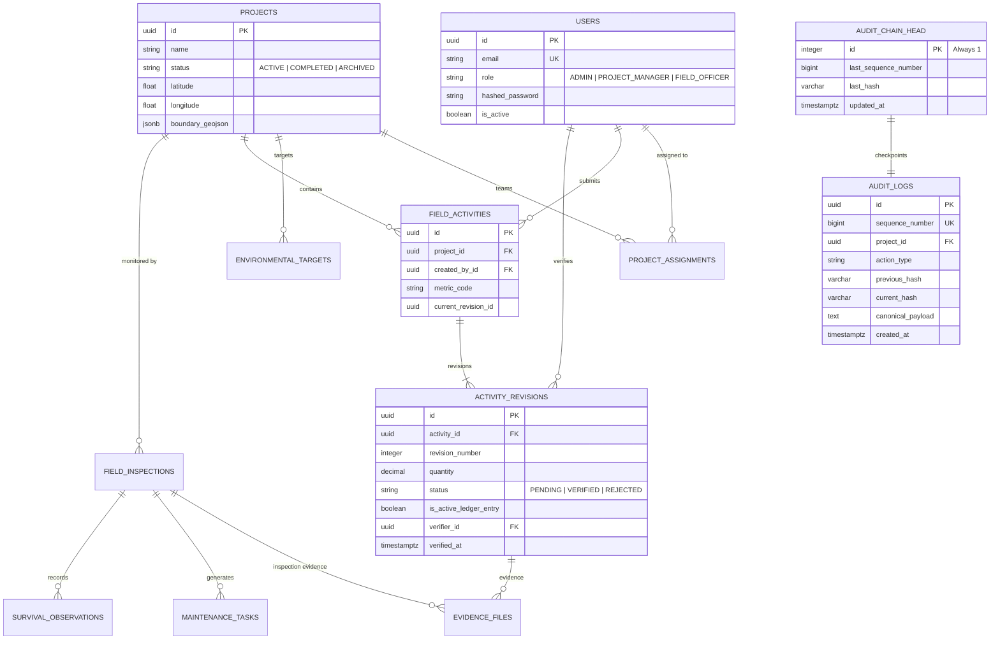

# VANA — Environmental Operations & Impact Intelligence Platform

[](https://github.com/snehapriy958/VANA)
[](docs/engineering/01_SYSTEM_ARCHITECTURE.md)
[](backend/tests/)
[](frontend/tests/)
[](LICENSE)
[](https://github.com/snehapriy958/VANA/releases)

**VANA** is an enterprise-grade Environmental Operations and Impact Intelligence Platform engineered for **Akshaya Vana Climate Ventures Private Limited**. The platform provides centralized project command, rigorous multi-tenant field verification, longitudinal ecological monitoring, and a cryptographically verifiable environmental achievement ledger across ecological restoration and carbon credit initiatives.

---

## 1. Problem Statement & The Golden Thread

Environmental initiatives worldwide suffer from a systemic credibility and verification deficit:
- **Double Counting:** Revisions and historical amendments frequently inflate claimed achievements.
- **Self-Reporting Bias:** Field agents often verify their own submissions without independent validation.
- **Unit Contamination:** Incompatible metrics (e.g. seedling counts vs. hectares vs. carbon tonnes) are illegitimately cross-aggregated.
- **Opaque Audit Trails:** Traditional database logs can be manipulated or rewritten without detection.

VANA bridges the gap between field actions and official environmental claims through a continuous operational loop:

$$\textbf{PLAN} \longrightarrow \textbf{ASSIGN} \longrightarrow \textbf{EXECUTE} \longrightarrow \textbf{RECORD} \longrightarrow \textbf{VERIFY} \longrightarrow \textbf{MEASURE} \longrightarrow \textbf{MONITOR}$$

### Core Operating Principles:
1. **Verified-Only Ledger:** Only active, approved (`VERIFIED`) activity revisions contribute to official environmental achievements. Pending and rejected revisions remain strictly isolated.
2. **Anti-Self-Verification Absolute:** Under no circumstances can a user verify their own submitted activity (`verifier_id != creator_id`).
3. **Strict Dimensional Integrity:** Metrics sharing different dimensional codes (e.g., `TREES`, `HECTARES`, `BIOMASS_T`) can never be cross-aggregated.
4. **Append-Only Cryptographic Ledger:** Every system mutation is sequenced monotonically and chained with SHA-256 digital digests over canonical JSON payloads.

---

## 2. Platform Architecture

VANA is architected as a **Domain-Driven Modular Monolith**, ensuring strong transactional consistency, physical separation between frontend and backend, and clear domain boundaries.

```
                           ┌──────────────────────────────────────────────┐
                           │          Vercel Global Edge CDN              │
                           │       React 19 Single Page Application       │
                           │   Vite • TypeScript • Tailwind • Lucide UI   │
                           └──────────────────────┬───────────────────────┘
                                                  │ HTTPS / REST (JSON)
                                                  ▼
                           ┌──────────────────────────────────────────────┐
                           │            Render Web Service                │
                           │       Python 3.12+ FastAPI Application       │
                           │   Pydantic DTOs • Async SQLAlchemy 2.0 ORM   │
                           ├──────────────────────────────────────────────┤
                           │             Domain Subsystems                │
                           │  • auth         • projects   • teams         │
                           │  • operations   • verify     • analytics     │
                           │  • monitoring   • audit      • storage       │
                           └──────────────┬──────────────────┬────────────┘
                                          │                  │
                             TCP (SSL)    │                  │ File I/O
                             (asyncpg)    ▼                  ▼ (/var/data)
                          ┌────────────────────┐    ┌─────────────────────┐
                          │  Neon PostgreSQL   │    │ Render Ext4 Disk    │
                          │   Serverless PG 17 │    │ 10 GB Storage Root  │
                          │   Ledger & Chains  │    │ Evidence File Vault │
                          └────────────────────┘    └─────────────────────┘
```

---

## 3. Technology Stack

| Layer | Approved Technology | Purpose & Selection Rationale |
|---|---|---|
| **Frontend Framework** | React 19 + Vite 6 | High-performance single page application with modern hooks and fast HMR |
| **Language (UI)** | TypeScript 5.7+ | Strict end-to-end static typing for financial & environmental metrics |
| **UI & Styling** | Tailwind CSS + shadcn/ui | Custom VANA brand tokens (`#183D32`, `#F5F3EA`, `#A8B99B`, `#D6A76A`, `#29332F`) |
| **State & Data Fetching** | TanStack Query 5 | Query caching, optimistic updates, and automatic cache invalidation |
| **Geospatial & Charts** | React Leaflet + Recharts | Interactive project mapping and longitudinal seedling survival curves |
| **Backend Framework** | Python 3.12+ + FastAPI | Async REST micro-framework with native OpenAPI documentation |
| **Database ORM** | SQLAlchemy 2.0 (Async) | Modern async SQL expressions with strict session lifecycles and row locking |
| **Database Migrations** | Alembic | Version-controlled, reversible schema alterations |
| **System of Record** | PostgreSQL 17 | Authoritative ACID relational storage with partial unique indices |
| **Authentication & RBAC** | Argon2id + PyJWT | Zero-knowledge password hashing and cryptographically signed JWT tokens |
| **Cloud Hosting** | Neon + Render + Vercel | Serverless PostgreSQL + persistent disk backend + global edge SPA |

---

## 4. Implemented Domain Modules

1. **Authentication & User Governance (`auth`):**
   - Argon2id password hashing, JWT access (60 min) and refresh (7 days) tokens.
   - Three-tier RBAC (`ADMIN`, `PROJECT_MANAGER`, `FIELD_OFFICER`).
   - Anti-self-role modification and project access authorization dependencies.
2. **Project Portfolio & Team Assignments (`projects`, `teams`):**
   - Project lifecycle management with geospatial coordinates and GeoJSON boundary polygons.
   - Project team assignments binding managers and field officers to specific project scopes.
3. **Environmental Target Catalog (`projects`):**
   - Multi-metric target definitions (trees planted, hectares restored, mangrove saplings, soil conserved).
   - Real-time progress tracking calculating verified vs. pending completion against targets.
4. **Field Operations & Secure Evidence (`operations`):**
   - Field report submissions with GPS coordinates, accuracy meters, and date stamps.
   - Content-addressed SHA-256 photographic evidence storage with directory traversal prevention.
   - Multi-revision amendment pipeline preserving historical submissions.
5. **Verification Centre (`verification`):**
   - Independent verification decision review queue for Project Managers.
   - Anti-Self-Verification rule enforcement (`verifier_id != creator_id`).
   - Mandatory rejection reason codes (`INSUFFICIENT_EVIDENCE`, `OUT_OF_BOUNDS`, `SUSPECTED_DUPLICATE`, etc.) with mandatory review notes.
6. **Environmental Ledger & Organization Dashboard (`analytics`):**
   - Mathematical calculation engine enforcing verified-only achievement accounting.
   - Live KPI cards, monthly activity streams, and environmental impact breakdown charts.
7. **Living Earth Interactive Map (`map`):**
   - Geospatial visualization rendered via React Leaflet.
   - Real-time project pins, status badges, and boundary polygon overlays.
8. **Field Monitoring & Longitudinal Survival (`monitoring`):**
   - Inspection scheduling, status transitions (`SCHEDULED` $\to$ `IN_PROGRESS` $\to$ `COMPLETED`), and photo addendums.
   - Maintenance task workflows (`WEEDING`, `PEST_CONTROL`, `IRRIGATION`, `REPLANTING`).
   - Seedling survival rate observations across sample plots with dynamic Recharts curve rendering.
9. **Audit History & Cryptographic Immutability Ledger (`audit`):**
   - Monotonic gapless sequence allocation with PostgreSQL row locking (`SELECT ... FOR UPDATE`).
   - Deterministic SHA-256 hash chaining using canonical JSON serialization.
   - Interactive 5-tab workspace (`/audit`) with dynamic before-and-after state diffing and on-demand chain verification.

---

## 5. Database Architecture & Entity Relationship Diagram (ERD)



### Authoritative Database Constraints:
- `uq_activity_single_active_ledger`: Partial unique index on `activity_revisions (activity_id)` WHERE `is_active_ledger_entry = True`. Mathematically guarantees zero double counting.
- `chk_active_ledger_verified`: CHECK constraint asserting that `is_active_ledger_entry = True` requires `status = 'VERIFIED'`.
- `chk_rejection_reason_required`: CHECK constraint requiring `rejection_reason_code` when `status = 'REJECTED'`.
- `chk_single_head_row`: Enforces `id = 1` on `audit_chain_head` as an atomic synchronization singleton.

---

## 6. Role-Based Access Control (RBAC) Matrix

| Workspace / Endpoint | ADMIN | PROJECT_MANAGER | FIELD_OFFICER |
|---|:---:|:---:|:---:|
| **Organization Dashboard** (`/dashboard`) | Organization-wide | Organization-wide | Organization-wide |
| **Team Management** (`/team`) | Full Management | View Assigned Team | Access Denied (403) |
| **Project Creation** (`/projects`) | Full Management | Access Denied (403) | Access Denied (403) |
| **Project Workspace** (`/projects/:id`) | All Projects | Assigned Projects Only | Assigned Projects Only |
| **Activity Submission** (`/operations`) | Permitted | Permitted | Permitted (Assigned Projects) |
| **Verification Centre** (`/verification`) | Organization-wide | Assigned Projects Only | Access Denied (403) |
| **Anti-Self-Verification Gate** | Enforced (Blocked) | Enforced (Blocked) | Enforced (Blocked) |
| **Field Monitoring** (`/monitoring`) | Organization-wide | Assigned Projects Only | Assigned Projects Only |
| **Audit History & Ledger** (`/audit`) | Organization-wide | Assigned Projects Only | Access Denied (403) |
| **Cryptographic Chain Verification** | Permitted | Permitted | Access Denied (403) |

---

## 7. Local Installation & Setup

### Prerequisites:
- Python 3.12+
- Node.js 20+ and npm 10+
- PostgreSQL 16+ (or local PostgreSQL 17 running on port 15432)

### Step 1: Clone Repository
```bash
git clone https://github.com/snehapriy958/VANA.git
cd VANA
```

### Step 2: Database Initialization
```bash
# Using psql or pgAdmin, create local development and test databases:
psql -U postgres -c "CREATE DATABASE vana_dev;"
psql -U postgres -c "CREATE DATABASE vana_test;"
```

### Step 3: Backend Setup & Migrations
```bash
cd backend
python -m venv .venv

# On Linux/macOS:
source .venv/bin/activate
# On Windows PowerShell:
.\.venv\Scripts\Activate.ps1

# Install dependencies
pip install -r requirements.txt

# Configure development environment
cp .env.example .env

# Apply database migrations to head
alembic upgrade head

# Start backend development server
uvicorn app.main:app --reload --host 127.0.0.1 --port 8000
```
- API Health Check: `http://127.0.0.1:8000/health`
- Interactive OpenAPI Docs: `http://127.0.0.1:8000/docs`

### Step 4: Frontend Setup & Dev Server
```bash
cd ../frontend
npm install

# Configure frontend environment
cp .env.example .env

# Start frontend dev server
npm run dev
```
- Access UI: `http://127.0.0.1:5173`

---

## 8. Demo Accounts & Credentials

### Pre-Seeded Local Accounts (Development Mode):

| Role | Email Address | Password | Scoping Scope |
|---|---|---|---|
| **Administrator** | `admin@vana.earth` | `SecurePass123!` | Organization-wide global access |
| **Project Manager** | `manager@vana.earth` | `SecurePass123!` | Assigned to Western Ghats project |
| **Field Officer** | `field@vana.earth` | `SecurePass123!` | Field submissions and evidence |

### Production Administrator Bootstrap:
In production, credentials are never hardcoded. Provision the root administrator via Render Web Shell:
```bash
export BOOTSTRAP_ADMIN_EMAIL="admin@vana.earth"
export BOOTSTRAP_ADMIN_NAME="System Administrator"
export BOOTSTRAP_ADMIN_PASSWORD="Your#Secure#Password#2026!"
python -m app.bootstrap_admin
```

---

## 9. Automated Testing & Verification Commands

All test suites run independently and achieve 100% pass rates:

```bash
# 1. Run Complete Backend Regression Suite (164 tests):
cd backend
pytest -q

# 2. Run Dedicated Audit & Cryptographic Ledger Tests (24 tests):
pytest tests/domains/audit/test_audit_ledger.py tests/domains/audit/test_audit_api.py -v

# 3. Run Full-Lifecycle 14-Step E2E Acceptance Test:
pytest tests/domains/audit/test_audit_e2e_acceptance.py -v

# 4. Run Frontend Automated Unit & Integration Tests (99 tests):
cd ../frontend
npm test -- --run

# 5. Run Frontend TypeScript Typecheck (0 errors):
npm run typecheck

# 6. Run Frontend Production Build:
npm run build
```

---

## 10. Production Deployment Architecture (Neon + Render + Vercel)

The deployment blueprint is specified in `render.yaml` and `frontend/vercel.json`:
- **Neon Cloud PostgreSQL:** Serverless PostgreSQL 17 with automated SSL connection pooling (`DATABASE_URL`) and direct migration connectivity (`ALEMBIC_DATABASE_URL`).
- **Render Web Service:** Automated Blueprint deploying Python 3.12, executing `preDeployCommand: alembic upgrade head`, with a 10 GB persistent disk mounted at `/var/data` for content-addressed photo evidence.
- **Vercel Edge Network:** Optimized Vite SPA deployment with client-side routing rewrites (`vercel.json`) and route-level lazy loading.
- **Full Deployment Blueprint:** Detailed step-by-step instructions in [docs/PRODUCTION_DEPLOYMENT_GUIDE.md](docs/PRODUCTION_DEPLOYMENT_GUIDE.md).

---

## 11. Known Limitations & Threat Boundaries

1. **SHA-256 Hash Chaining is Tamper-Evident, Not Tamper-Proof Against Superusers:**
   - The cryptographic ledger guarantees tamper detection against application users, compromised API tokens, and ad-hoc SQL modifications.
   - However, an adversary possessing direct PostgreSQL superuser write credentials (`postgres` role with table alter and trigger disable privileges) could conceivably modify rows, recompute downstream hashes, and update `audit_chain_head`.
   - *Mitigation:* Periodic chain-head hash checkpoints should be anchored to an external write-once ledger (e.g. RFC 3161 timestamping server or public blockchain notary) for complete non-repudiation.
2. **Current Spatial Support:**
   - Project coordinates and GeoJSON polygons are stored in PostgreSQL JSONB and rendered client-side via React Leaflet. Specialized spatial intersections (PostGIS) are deferred to post-MVP scale.

---

## 12. Future Improvements Roadmap

- **PostGIS Spatial Analytics:** Server-side polygon intersection to detect overlapping project claims and boundary disputes.
- **Offline Progressive Web App (PWA):** IndexedDB observation caching enabling remote field reporting without cellular connectivity.
- **External Cryptographic Notarization:** Daily anchoring of `audit_chain_head` hashes to Ethereum L2 or AWS QLDB.
- **Satellite Biomass Ingestion:** Ingesting Sentinel-2 multispectral imagery for automated NDVI vegetation verification.

---

## 13. Assignment Submission Deliverables

- [x] **GitHub Repository:** [https://github.com/snehapriy958/VANA](https://github.com/snehapriy958/VANA) (Release: `v1.0.0-rc1`)
- [x] **Production Deployment Runbook:** [docs/PRODUCTION_DEPLOYMENT_GUIDE.md](docs/PRODUCTION_DEPLOYMENT_GUIDE.md)
- [x] **Environment Variables Specification:** [docs/PRODUCTION_ENVIRONMENT_VARIABLES.md](docs/PRODUCTION_ENVIRONMENT_VARIABLES.md)
- [x] **Pre-Deployment Acceptance Checklist:** [docs/PRODUCTION_ACCEPTANCE_CHECKLIST.md](docs/PRODUCTION_ACCEPTANCE_CHECKLIST.md)
- [x] **Disaster Recovery & Backup Guide:** [docs/BACKUP_AND_RESTORE.md](docs/BACKUP_AND_RESTORE.md)
- [x] **Demonstration Video Script:** [docs/DEMO_VIDEO_SCRIPT.md](docs/DEMO_VIDEO_SCRIPT.md)
- [x] **AI Assistance Disclosure:** [docs/AI_ASSISTANCE_DISCLOSURE.md](docs/AI_ASSISTANCE_DISCLOSURE.md)
- [x] **Technical Assignment Checklist:** [docs/AKSHAYA_VANA_SUBMISSION_CHECKLIST.md](docs/AKSHAYA_VANA_SUBMISSION_CHECKLIST.md)

---

## 14. Governance & Architecture History

- **Permanent Engineering Rules:** [AGENTS.md](AGENTS.md)
- **Architectural Decision Records:** [DECISION_LOG.md](DECISION_LOG.md) (ADR-001 through ADR-028)
- **Milestone Implementation Tracking:** [IMPLEMENTATION_STATUS.md](IMPLEMENTATION_STATUS.md)
- **Final Pre-Deployment Acceptance Report:** [docs/FINAL_PRE_DEPLOYMENT_ACCEPTANCE_REPORT.md](docs/FINAL_PRE_DEPLOYMENT_ACCEPTANCE_REPORT.md)
