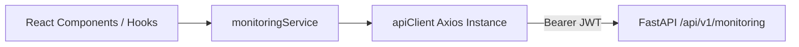

# VANA Phase 6.4: Frontend API Integration — Completion Report

**Date:** 2026-11-04  
**Status:** COMPLETED & VERIFIED  
**Milestone:** Phase 6.4 — Frontend API Integration & TanStack Query State Architecture  
**Target Architecture:** React 19 SPA, TypeScript, TanStack Query v5, Axios, Zod, Node.js Test Runner  

---

## 1. Executive Summary

Phase 6.4 introduces the frontend data access layer for VANA's Field Monitoring & Follow-up Management module. It connects the 19 FastAPI REST endpoints introduced in Phase 6.3 to the React 19 frontend application via strongly typed TypeScript contracts, a centralized Axios API service, unified error normalization, and reactive TanStack Query hooks with targeted cache invalidation.

In strict accordance with Phase 6.4 scoping rules:
* **Zero UI Components Built:** No React monitoring views, routes, modals, tables, or charts were introduced; the user interface is strictly reserved for Phase 6.5.
* **Zero Backend or Migration Alterations:** Backend services, database models, and Alembic migrations remained 100% untouched.
* **Unified Infrastructure:** Reused the shared `apiClient` instance without creating duplicate Axios instances or independent token logic.
* **Scientific Integrity Safeguards:** Enforced server-derived survival rate calculations; client requests strictly drop/reject client-supplied rates.

---

## 2. Files Created and Modified

### Created Files
| File Path | Description | Lines of Code |
| :--- | :--- | :--- |
| `frontend/src/types/monitoring.ts` | Complete TypeScript type definitions matching backend FastAPI schemas | 276 |
| `frontend/src/services/monitoringService.ts` | Monitoring API client covering all 19 endpoints across 6 domains | 309 |
| `frontend/src/hooks/useMonitoring.ts` | TanStack Query v5 hooks (9 queries, 13 mutations, query key factory) | 465 |
| `frontend/tests/monitoring.test.mjs` | Automated frontend unit and integration tests (29 tests across 6 suites) | 430 |
| `docs/PHASE_6_4_COMPLETION_REPORT.md` | Comprehensive milestone completion report | — |

### Modified Files
| File Path | Description | Changes |
| :--- | :--- | :--- |
| `frontend/src/services/apiClient.ts` | Enhanced response interceptor for FastAPI/Pydantic error normalization; added `extractErrorMessage` utility | +34 / -4 lines |
| `frontend/src/types/index.ts` | Re-exported all monitoring type definitions for application-wide imports | +2 lines |
| `IMPLEMENTATION_STATUS.md` | Updated milestone matrix and detailed deliverables verification | +50 lines |
| `DECISION_LOG.md` | Recorded ADR-020 (Phase 6.3 API) and ADR-021 (Phase 6.4 Integration) | +43 lines |

---

## 3. TypeScript Domain Contracts (`frontend/src/types/monitoring.ts`)

All TypeScript definitions map 1:1 to the FastAPI OpenAPI schemas and PostgreSQL domain models:

### 1. Enums and Literal Types
* `InspectionStatus`: `"SCHEDULED" | "IN_PROGRESS" | "COMPLETED" | "CANCELLED"`
* `InspectionType`: `"ROUTINE" | "SURVIVAL_CHECK" | "MAINTENANCE_AUDIT" | "EMERGENCY"`
* `CanopyCondition`: `"EXCELLENT" | "HEALTHY" | "STRESSED" | "CRITICAL"`
* `SoilMoistureCondition`: `"SATURATED" | "ADEQUATE" | "DRY" | "SEVERELY_PARCHED"`
* `MaintenanceTaskStatus`: `"TODO" | "IN_PROGRESS" | "COMPLETED" | "CANCELLED"`
* `MaintenanceTaskCategory`: `"IRRIGATION" | "WEEDING" | "MULCHING" | "FENCING_REPAIR" | "REPLANTING_PREP" | "PEST_CONTROL" | "SOIL_ENRICHMENT" | "OTHER"`
* `MaintenanceTaskPriority`: `"LOW" | "MEDIUM" | "HIGH" | "URGENT"`
* `SurvivalMethodology`: `"SAMPLE_PLOT" | "TRANSECT" | "FULL_CENSUS"`
* `AlertType`: `"OVERDUE_INSPECTION" | "UPCOMING_INSPECTION" | "OVERDUE_TASK"`
* `AlertSeverity`: `"HIGH" | "MEDIUM" | "LOW"`

### 2. Request & Response Interfaces
* **Field Inspections:** `FieldInspection`, `InspectionCreateRequest`, `InspectionStartRequest`, `InspectionCompleteRequest`, `InspectionCancelRequest`, `InspectionAddendumCreate`, `InspectionAddendum`, `InspectionEvidence`.
* **Maintenance Tasks:** `MaintenanceTask`, `MaintenanceTaskCreateRequest`, `TaskStartRequest`, `TaskCompleteRequest`, `TaskCancelRequest`, `TaskReopenRequest`.
* **Survival Observations:** `SurvivalObservation`, `SurvivalObservationCreateRequest` *(omits client-side rate)*, `SurvivalObservationCorrectionRequest`, `SurvivalAnalytics`.
* **Alerts & Dashboard:** `MonitoringAlert`, `MonitoringAlertSummary`, `MonitoringDashboard`.
* **Filters & Pagination:** `InspectionFilterParams`, `TaskFilterParams`, `SurvivalFilterParams`, `MonitoringFilterParams`, `PaginatedMonitoringResponse<T>`.

---

## 4. Monitoring API Service (`frontend/src/services/monitoringService.ts`)

Implemented 19 methods consuming `/api/v1/monitoring/*`:



### Methods Inventory
1. **Field Inspections (8 methods):**
   * `scheduleInspection(data: InspectionCreateRequest): Promise<FieldInspection>` (`POST /monitoring/inspections`)
   * `listInspections(params?: InspectionFilterParams): Promise<FieldInspection[]>` (`GET /monitoring/inspections`)
   * `getInspection(id: string): Promise<FieldInspection>` (`GET /monitoring/inspections/{id}`)
   * `startInspection(id: string, data?: InspectionStartRequest): Promise<FieldInspection>` (`POST /monitoring/inspections/{id}/start`)
   * `completeInspection(id: string, data: InspectionCompleteRequest): Promise<FieldInspection>` (`POST /monitoring/inspections/{id}/complete`)
   * `cancelInspection(id: string, data: InspectionCancelRequest): Promise<FieldInspection>` (`POST /monitoring/inspections/{id}/cancel`)
   * `addInspectionAddendum(id: string, data: InspectionAddendumCreate): Promise<FieldInspection>` (`POST /monitoring/inspections/{id}/addendum`)
   * `uploadInspectionEvidence(id: string, fileOrFormData: File | FormData, metadata?: ...): Promise<InspectionEvidence>` (`POST /monitoring/inspections/{id}/evidence`)

2. **Maintenance Tasks (7 methods):**
   * `createTask(data: MaintenanceTaskCreateRequest): Promise<MaintenanceTask>` (`POST /monitoring/tasks`)
   * `listTasks(params?: TaskFilterParams): Promise<MaintenanceTask[]>` (`GET /monitoring/tasks`)
   * `getTask(id: string): Promise<MaintenanceTask>` (`GET /monitoring/tasks/{id}`)
   * `startTask(id: string, data?: TaskStartRequest): Promise<MaintenanceTask>` (`POST /monitoring/tasks/{id}/start`)
   * `completeTask(id: string, data: TaskCompleteRequest): Promise<MaintenanceTask>` (`POST /monitoring/tasks/{id}/complete`)
   * `cancelTask(id: string, data: TaskCancelRequest): Promise<MaintenanceTask>` (`POST /monitoring/tasks/{id}/cancel`)
   * `reopenTask(id: string, data: TaskReopenRequest): Promise<MaintenanceTask>` (`POST /monitoring/tasks/{id}/reopen`)

3. **Survival Observations (4 methods):**
   * `createSurvivalObservation(data: SurvivalObservationCreateRequest): Promise<SurvivalObservation>` (`POST /monitoring/survival-observations`)
   * `listSurvivalObservations(params: SurvivalFilterParams): Promise<SurvivalObservation[]>` (`GET /monitoring/survival-observations`)
   * `getSurvivalObservation(id: string): Promise<SurvivalObservation>` (`GET /monitoring/survival-observations/{id}`)
   * `correctSurvivalObservation(id: string, data: SurvivalObservationCorrectionRequest): Promise<SurvivalObservation>` (`POST /monitoring/survival-observations/{id}/correct`)

4. **Longitudinal Trajectory Analytics (1 method):**
   * `getSurvivalAnalytics(params: { projectId: string; plotIdentifier: string; cohortIdentifier: string }): Promise<SurvivalAnalytics[]>` (`GET /monitoring/survival-analytics`)

5. **Alerts & Dashboard (2 methods):**
   * `getMonitoringAlerts(projectId?: string): Promise<MonitoringAlertSummary>` (`GET /monitoring/alerts`)
   * `getMonitoringDashboard(projectId?: string): Promise<MonitoringDashboard>` (`GET /monitoring/dashboard`)

---

## 5. TanStack Query Hooks & Cache Architecture (`frontend/src/hooks/useMonitoring.ts`)

### 1. Hierarchical Query Key Factory
Standardized query keys prevent collisions and allow targeted invalidations:
```ts
monitoringKeys = {
  all: ["monitoring"],
  inspections: () => ["monitoring", "inspections"],
  inspectionList: (filters) => ["monitoring", "inspections", "list", filters ?? {}],
  inspectionDetail: (id) => ["monitoring", "inspections", "detail", id],
  tasks: () => ["monitoring", "tasks"],
  taskList: (filters) => ["monitoring", "tasks", "list", filters ?? {}],
  taskDetail: (id) => ["monitoring", "tasks", "detail", id],
  survival: () => ["monitoring", "survival"],
  survivalList: (filters) => ["monitoring", "survival", "list", filters],
  survivalDetail: (id) => ["monitoring", "survival", "detail", id],
  survivalTrajectory: (projectId, plotId, cohortId) => ["monitoring", "survival", "trajectory", projectId, plotId, cohortId],
  alerts: (projectId) => ["monitoring", "alerts", projectId ?? "all"],
  dashboard: (projectId) => ["monitoring", "dashboard", projectId ?? "all"],
}
```

### 2. Cache Invalidation Matrix
To prevent stale dashboards, alerts, and list views, mutations automatically invalidate dependent queries:

| Mutation Hook | Query Keys Invalidated |
| :--- | :--- |
| `useScheduleInspection` | `inspections`, `dashboard`, `alerts` |
| `useStartInspection` | `inspections`, `inspectionDetail(id)`, `dashboard`, `alerts` |
| `useCompleteInspection` | `inspections`, `inspectionDetail(id)`, `dashboard`, `alerts` |
| `useCancelInspection` | `inspections`, `inspectionDetail(id)`, `dashboard`, `alerts` |
| `useAddInspectionAddendum` | `inspections`, `inspectionDetail(id)` |
| `useUploadInspectionEvidence` | `inspections`, `inspectionDetail(id)` |
| `useCreateMaintenanceTask` | `tasks`, `dashboard`, `alerts` |
| `useStartMaintenanceTask` | `tasks`, `taskDetail(id)`, `dashboard`, `alerts` |
| `useCompleteMaintenanceTask` | `tasks`, `taskDetail(id)`, `dashboard`, `alerts` |
| `useCancelMaintenanceTask` | `tasks`, `taskDetail(id)`, `dashboard`, `alerts` |
| `useReopenMaintenanceTask` | `tasks`, `taskDetail(id)`, `dashboard`, `alerts` |
| `useCreateSurvivalObservation` | `survival`, `dashboard` |
| `useCorrectSurvivalObservation` | `survival`, `dashboard` |

---

## 6. Centralized Error Handling (`frontend/src/services/apiClient.ts`)

The response interceptor in `apiClient.ts` was upgraded to normalize all error formats emitted by FastAPI, Pydantic, and PostgreSQL:
* **String Details (`400 Bad Request`, `403 Forbidden`, `404 Not Found`):** Extracts `errorData.detail` directly (e.g. `"Cannot edit a completed inspection"`).
* **Structured Details (`{"detail": {"message": ...}}`):** Extracts `errorData.detail.message`.
* **Validation Arrays (`422 Unprocessable Entity`):** Maps Pydantic field errors `[{ loc: ["body", "findings"], msg: "Field required" }]` into clean, human-readable strings.
* **Conflict Errors (`409 Conflict`):** Extracts duplicate observation or already superseded errors without opaque network failure masks.
* **Authentication Expiration (`401 Unauthorized`):** Triggers `onUnauthorizedCallback` to purge in-memory credentials and redirect to login.
* **Network / Offline Failures:** Falls back safely to `error.message` or `"An unexpected network error occurred."`.

---

## 7. Verification & Test Results

### 1. Frontend Test Suite
Executed via Node.js native test runner (`npm --prefix frontend test`):
* **Authentication & RBAC Suite:** 5/5 passed
* **Environmental Dashboard & Ledger Suite:** 5/5 passed
* **Field Operations & Verification Suite:** 7/7 passed
* **Project Portfolio & Workspace Suite:** 9/9 passed
* **Phase 6.4 Monitoring Integration Suite:** **29/29 passed**
  * Client Request Schemas & Validation Contracts: 8 tests passed
  * Survival Observation Integrity & Server-Derived Calculation: 4 tests passed
  * TanStack Query Key Factory Conventions & Hierarchy: 4 tests passed
  * Mutation Cache Invalidation Matrix: 3 tests passed
  * Centralized Error Normalization Matrix: 8 tests passed
  * Multipart Evidence FormData Construction: 1 test passed
* **Total Frontend Tests:** **61/61 passed (100% pass rate in 196ms)**.

### 2. TypeScript Typecheck & Production Build
* **Typecheck (`tsc --noEmit`):** Clean exit (code 0, 0 errors).
* **Composite Build (`tsc -b && vite build`):** Clean exit (code 0, 2237 modules transformed into production bundle in 14.73s).

### 3. Backend Regression Suite
Executed via Pytest (`pytest -v`):
* **Monitoring Schema & Migration:** 11/11 passed
* **Monitoring Domain Services:** 16/16 passed
* **Monitoring API Integration:** 6/6 test suites passed
* **Total Backend Regression:** **118/118 passed (100% pass rate in 54.92s)** with 0 regressions.

---

## 8. Known Limitations & Next Steps

### Known Limitations
1. **No UI Views Yet:** As mandated by the milestone scope, UI pages, navigation links, and modals are not yet rendered in the browser.
2. **Mock Evidence in Unit Tests:** Evidence upload unit testing validates payload shape and FormData serialization; live browser file uploads will be verified end-to-end in Phase 6.5.

### Next Steps (Phase 6.5: Field Monitoring UI Workspaces)
Upon receiving explicit user approval:
1. Create `FieldMonitoringView` with tabbed navigation (Inspections, Tasks, Survival Monitoring, Dashboard).
2. Build inspection scheduling, execution, and addendum modals.
3. Build maintenance task creation, completion, and reopening dialogs.
4. Build survival observation recording form, correction/supersession modal, and Recharts longitudinal trajectory curves.
5. Build active alerts badge panel and operational backlog KPIs.
