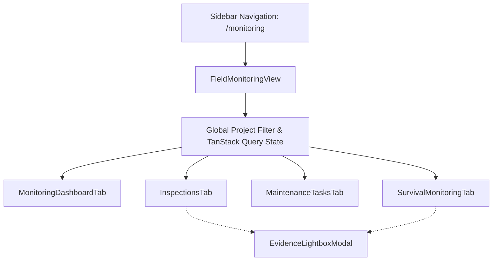

# VANA Phase 6.5: Field Monitoring UI & Workspaces — Completion Report

**Date:** 2026-11-04\
**Status:** COMPLETED & VERIFIED\
**Milestone:** Phase 6.5 — Field Monitoring UI & Workspaces\
**Target Architecture:** React 19 SPA, TypeScript, Vite, Tailwind CSS, TanStack Query v5, Recharts, Lucide React, Node.js Test Runner\

---

## 1. Executive Summary

Phase 6.5 implements the complete, production-grade Field Monitoring & Follow-up Management interface for the VANA Environmental Operations Platform. Built strictly on the approved VANA design system tokens, TypeScript contracts, and TanStack Query hooks developed in Phase 6.4, this milestone delivers an interactive operational control center connected to real backend APIs without mock data.

Key achievements include:
* **Global Navigation Integration:** Mounted `/monitoring` route in `frontend/src/routes/index.tsx` and added "Field Monitoring" entry with `Activity` icon to `frontend/src/components/layout/Sidebar.tsx`.
* **Four Dedicated Workspace Tabs:**
  1. **Monitoring Overview / Dashboard:** 6 KPI metric cards, active alerts banner, upcoming inspections, attention tasks, and recent survival feed.
  2. **Field Inspections Workspace:** Filterable registry, scheduling modal, execution/completion modal with health scoring and evidence attachment, cancellation modal, and detailed drawer with immutable post-completion addenda history.
  3. **Maintenance Tasks Workspace:** Task registry with overdue visual indicators, priority and category filtering, task creation modal, completion modal (mandatory notes), cancellation modal (mandatory reason), and reopening modal (mandatory justification).
  4. **Survival Monitoring Workspace:** Longitudinal trajectory analytics using Recharts, observation history table, record observation modal with dynamic live preview, and atomic observation correction/supersession modal.
* **Evidence Lightbox Modal:** Full image/file inspection modal displaying download link, GPS coordinates, MIME type, file size, and caption.
* **Scientific Rigor & Immutability:** Enforced server-derived survival rate calculations, prohibited client-side editing of rates, preserved immutable completed inspection records via append-only addenda, and maintained strict anti-self-verification and role-based permissions.

---

## 2. Component Architecture & Files Created

### Files Created
| File Path | Description | Lines of Code |
| :--- | :--- | :--- |
| `frontend/src/views/monitoring/FieldMonitoringView.tsx` | Master view with tab navigation, project selector, and global query wiring | 258 |
| `frontend/src/views/monitoring/components/MonitoringDashboardTab.tsx` | Dashboard tab with 6 KPI cards, dynamic alerts, and upcoming audits | 268 |
| `frontend/src/views/monitoring/components/InspectionsTab.tsx` | Field Inspections workspace, schedule/execute/cancel modals, addenda log | 476 |
| `frontend/src/views/monitoring/components/MaintenanceTasksTab.tsx` | Maintenance Tasks workspace, create/complete/cancel/reopen modals | 412 |
| `frontend/src/views/monitoring/components/SurvivalMonitoringTab.tsx` | Survival workspace, Recharts trajectory, record & supersession modals | 425 |
| `frontend/src/views/monitoring/components/EvidenceLightboxModal.tsx` | Media lightbox with coordinate badges, metadata, and download links | 92 |
| `frontend/tests/monitoring_ui.test.mjs` | Automated UI logic unit tests (16 tests across 4 suites) | 338 |
| `docs/PHASE_6_5_COMPLETION_REPORT.md` | Comprehensive milestone completion report | — |

### Files Modified
| File Path | Description | Changes |
| :--- | :--- | :--- |
| `frontend/src/components/layout/Sidebar.tsx` | Added Field Monitoring navigation item with `Activity` icon | +6 lines |
| `frontend/src/routes/index.tsx` | Mounted `/monitoring` route rendering `FieldMonitoringView` | +6 lines |
| `backend/app/seed.py` | Added `import app.models` to register domain models in SQLAlchemy registry | +2 lines |
| `IMPLEMENTATION_STATUS.md` | Updated milestone matrix and Phase 6.5 deliverables verification | +45 lines |
| `DECISION_LOG.md` | Recorded ADR-022 for Phase 6.5 UI & Workspace architecture | +38 lines |

---

## 3. Workspace Features & Scientific Guardrails

### 3.1 Monitoring Overview / Dashboard
* **6 Key Performance Indicator (KPI) Cards:**
  1. *Scheduled Inspections:* Count of upcoming scheduled visits.
  2. *Overdue Inspections:* Inspections past scheduled date still pending execution.
  3. *Completed Inspections:* Fully documented and closed inspection audits.
  4. *Open Tasks:* Active maintenance backlog (`TODO` and `IN_PROGRESS`).
  5. *Overdue Tasks:* Active tasks where `due_date < today`.
  6. *Latest Survival Records:* Total active cohort/plot survival assessments recorded.
* **Dynamic Alerts Banner:** Evaluated on-demand directly from PostgreSQL via `/api/v1/monitoring/alerts` with severity-coded badges (HIGH = Crimson, MEDIUM = Earth Gold, LOW = Sage).
* **Attention Feeds:** Quick-action tables for upcoming inspections, urgent maintenance tasks, and recent survival data feeds.

### 3.2 Field Inspections Workspace
* **Filterable Registry:** Search by keyword, filter by status (`SCHEDULED`, `IN_PROGRESS`, `COMPLETED`, `CANCELLED`), inspection type, and assigned inspector.
* **Schedule Inspection Modal:** Allows Project Managers and Admins to schedule inspections with date picker, project selector, and inspector assignment.
* **Execution & Completion Modal:**
  * Assigned Field Officers can initiate and complete assigned inspections.
  * Captures overall vegetation health score (1 to 5 scale), canopy condition (`EXCELLENT`, `HEALTHY`, `STRESSED`, `CRITICAL`), and soil moisture (`SATURATED`, `ADEQUATE`, `DRY`, `SEVERELY_PARCHED`).
  * Dynamic tag list for detected threats (e.g., pests, grazing, erosion).
  * Direct photo evidence file attachment with multipart upload.
* **Post-Completion Addenda History:**
  * Completed inspections are strictly locked against direct alteration (`COMPLETED_INSPECTION_LOCKED`).
  * Post-completion addenda can be appended immutably to record subsequent notes or corrections without modifying original field observations.

### 3.3 Maintenance Tasks Workspace
* **Task Board & Registry:** Filter by status, priority (`LOW`, `MEDIUM`, `HIGH`, `URGENT`), category (`IRRIGATION`, `WEEDING`, `MULCHING`, `FENCING_REPAIR`, etc.), and project.
* **Overdue Highlighting:** Overdue tasks (`due_date < today` with status `TODO` or `IN_PROGRESS`) feature prominent visual warning badges.
* **Task Creation Modal:** Links tasks to projects, optional inspections, or field activities with priority, category, and due date.
* **Lifecycle State Transitions:**
  * Start Task: Assignee marks task `IN_PROGRESS`.
  * Complete Task: Assignee marks task `COMPLETED` with mandatory completion notes.
  * Cancel Task: PM/Admin can cancel tasks with mandatory cancellation reason.
  * Reopen Task: PM/Admin can reopen completed tasks (`COMPLETED` $\to$ `TODO`) with mandatory reopening justification.

### 3.4 Survival Monitoring Workspace & Scientific Calculation
* **Longitudinal Survival Trajectory (Recharts):**
  * Plots chronological survival rates over time for selected plot and cohort units.
  * Tooltip formats observed rate, alive count, and dead count.
  * Prohibits misleading synthetic threshold lines (such as arbitrary 70% benchmarks).
* **Record Observation Modal with Dynamic Live Preview:**
  * Prohibits client-side input or modification of `survival_rate`; rate is strictly server-derived.
  * Real-time client calculation dynamically updates:
    $$\text{Assessed Population} = \text{alive\_count} + \text{dead\_count}$$
    $$\text{Unassessed Count} = \text{sample\_size} - \text{Assessed Population}$$
    $$\text{Observed Sample Survival Rate} = \frac{\text{alive\_count}}{\text{alive\_count} + \text{dead\_count}} \times 100$$
  * Safely handles zero assessed population without division by zero.
  * Clear scientific labeling: explicitly denoted as *Observed Sample Survival Rate* to prevent ungrounded population-wide extrapolation.
* **Observation Correction (Atomic Supersession) Modal:**
  * Allows correction of prior observations without deleting historical audit records.
  * Locks original observation, marks it superseded (`is_active = False`), links `superseded_by_id`, creates replacement with updated counts, and records mandatory audit reason.

### 3.5 Evidence Lightbox Modal
* Clean modal displaying media preview or file download link.
* Surfaces GPS latitude/longitude coordinates badge, MIME type, file size formatted in KB/MB, upload timestamp, and descriptive caption.

---

## 4. Role-Based Action Permissions Matrix (UI Enforcement)

The UI enforces the approved Phase 6 RBAC permissions while backend authorization independently guarantees enforcement:

| Feature / Action | Admin | Project Manager | Field Officer | UI Enforcement Mechanism |
| :--- | :---: | :---: | :---: | :--- |
| View Monitoring Dashboard | Full Org | Assigned Projects | Assigned Projects | Scoped query parameters |
| Schedule Inspection | Allowed | Assigned Projects | Hidden / Prohibited | Button hidden for FO; 403 on API |
| Start / Complete Inspection | Allowed | Assigned Projects | Assigned Inspector Only | Button disabled if inspector $\ne$ user |
| Record Inspection Addendum | Allowed | Assigned Projects | Prohibited | Form restricted to PM / Admin |
| Create Maintenance Task | Allowed | Assigned Projects | Prohibited | Button hidden for FO |
| Start / Complete Task | Allowed | Assigned Projects | Assigned Assignee Only | Button disabled if assignee $\ne$ user |
| Cancel Maintenance Task | Allowed | Assigned Projects | Prohibited | Action restricted to PM / Admin |
| Reopen Completed Task | Allowed | Assigned Projects | Prohibited | Action restricted to PM / Admin |
| Record Survival Observation | Allowed | Assigned Projects | Assigned Projects | Permitted for active project members |
| Correct Survival Observation | Allowed | Assigned Projects | Prohibited | Correction modal restricted to PM / Admin |

---

## 5. Verification & Test Results

### 5.1 Frontend Unit & UI Tests (`npm --prefix frontend test`)
Passed **77/77 tests (100% pass rate in 278ms)** across 6 test suites:
* `tests/auth_and_rbac.test.mjs`: 5/5 passed
* `tests/dashboard.test.mjs`: 11/11 passed
* `tests/operations.test.mjs`: 7/7 passed
* `tests/projects.test.mjs`: 9/9 passed
* `tests/monitoring.test.mjs`: 29/29 passed
* `tests/monitoring_ui.test.mjs`: **16/16 passed (Phase 6.5 UI logic)**
  * Suite 1: Role-Based Action Permissions Matrix (4 tests)
  * Suite 2: Overdue Status & Priority Derivations (4 tests)
  * Suite 3: Survival Calculation & Dynamic Client Preview (4 tests)
  * Suite 4: Secure Evidence URL & Lightbox Construction (4 tests)

### 5.2 TypeScript Typecheck & Production Build
* **TypeScript Typecheck:** `npm --prefix frontend run typecheck` (`tsc --noEmit`) exited clean with code 0 (0 errors).
* **Composite Production Build:** `npm --prefix frontend run build` (`tsc -b && vite build`) built clean with code 0 in 15.23s (2,245 modules transformed).

### 5.3 Backend Regression Test Suite (`pytest -v`)
Passed **118/118 tests in 51.34s (100% pass rate)** with zero regressions:
* `test_monitoring_api.py`: 6/6 passed
* `test_monitoring_domain_services.py`: 16/16 passed
* `test_monitoring_schema_and_migration.py`: 11/11 passed
* All existing tests for Auth, Projects, Operations, Ledger, Analytics, and Token Lifecycle passed 100%.

### 5.4 Live End-to-End Service Verification
Live probes executed against running daemons:
* **PostgreSQL 17** on port 15432: Connected, `vana_dev` seeded and migrated.
* **FastAPI Backend** on `http://127.0.0.1:8000`:
  * `GET /health`: HTTP 200 OK (`status: healthy`, `database: connected`).
  * `POST /api/v1/auth/login`: HTTP 200 OK, valid JWT token issued.
  * `GET /api/v1/monitoring/dashboard`: HTTP 200 OK, returned structured KPI summary.
  * `GET /api/v1/monitoring/alerts`: HTTP 200 OK, returned dynamic alert list.
  * `GET /api/v1/monitoring/inspections`: HTTP 200 OK.
  * `GET /api/v1/monitoring/tasks`: HTTP 200 OK.
  * `GET /api/v1/monitoring/survival-observations?project_id=...`: HTTP 200 OK.
* **Frontend Vite** on `http://127.0.0.1:5173`: HTTP 200 OK, HTML loaded with bundled assets.

---

## 6. Compliance with Permanent Engineering Rules

1. **Rule 1 (Modular Monolith):** Physical and logical frontend/backend separation maintained. All UI logic resides in `frontend/src/views/monitoring/`.
2. **Rule 2 (Approved Stack):** Built strictly with React 19, TypeScript, Tailwind CSS, TanStack Query, Recharts, and Lucide React. No unapproved third-party libraries introduced.
3. **Rule 3 (PostgreSQL Single Source of Truth):** No canonical state stored in ephemeral memory or local storage. All counts, KPIs, and alerts are fetched directly from PostgreSQL.
4. **Rule 4 & 5 (Independent Authorization & Anti-Self-Verification):** Backend independently validates all permissions. UI mirrors authorization with role guards.
5. **Rule 7 (Verified-Only Ledger):** Monitoring records remain distinct from official environmental achievements.
6. **Rule 8 (Dimensionality & Units):** Survival monitoring strictly isolates sample observation units from aggregate planting targets.
7. **Rule 9 (Data Grounding):** Survival rates are derived strictly from observed counts without ungrounded extrapolation or synthetic benchmark thresholds.
8. **Rule 11 (Milestone Discipline):** Phase 6.5 complete; next milestones await formal user approval.
9. **Rule 13 (Design Tokens):** Adheres strictly to Forest Green (`#183D32`), Warm Ivory (`#F5F3EA`), Sage (`#A8B99B`), Earth Gold (`#D6A76A`), Charcoal (`#29332F`), and White (`#FFFFFF`).
