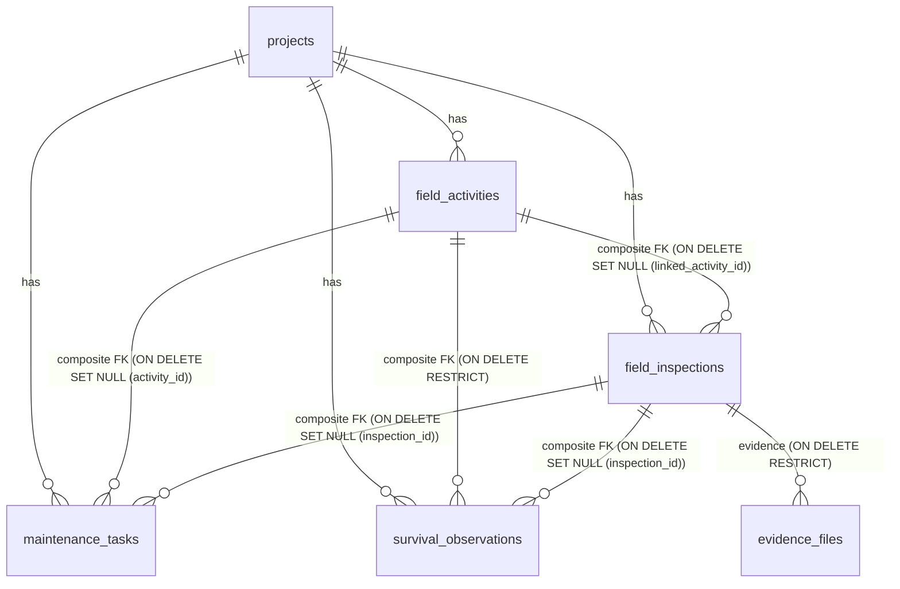
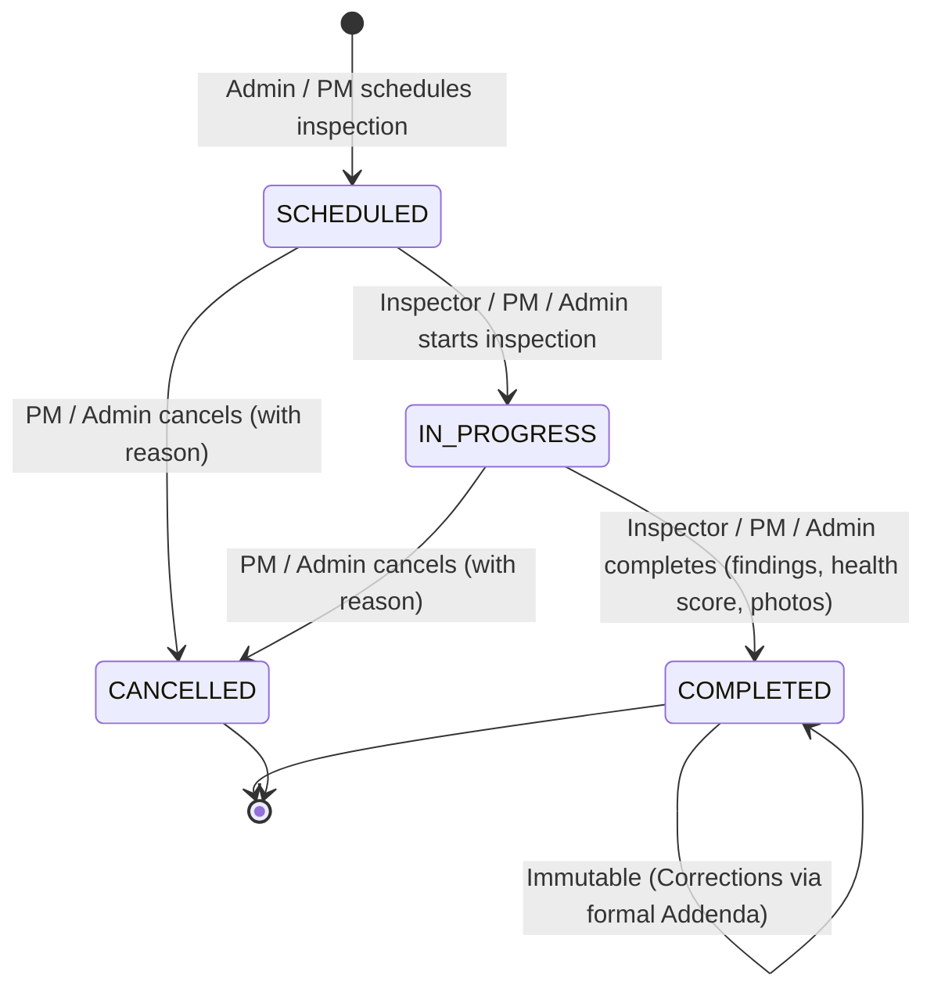
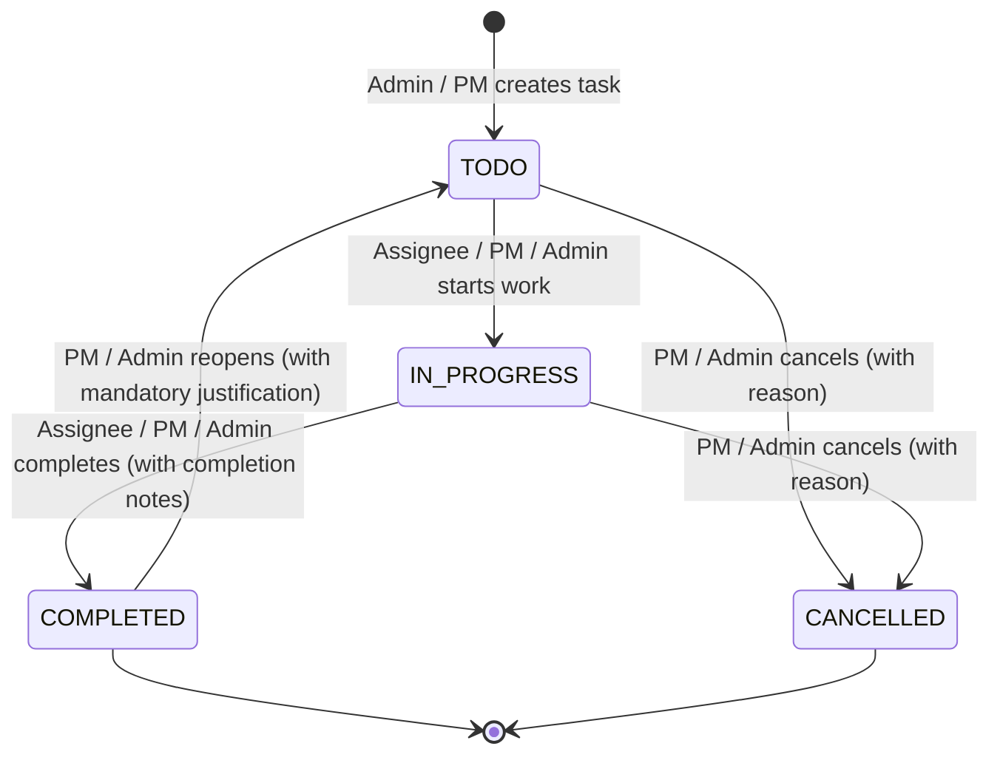

# VANA Phase 6 — Field Monitoring & Follow-up Management: Architecture & System Design

> **Document Status:** Final Gate Approved with Database Integrity Corrections\
> **Release Target:** VANA Phase 6 (Milestone 6)\
> **Domain Package:** `backend/app/domains/monitoring`\
> **Traceability:** Aligns with `AGENTS.md` (Rules 1, 4, 6, 7, 8, 9), `docs/PHASE_6_FINAL_IMPLEMENTATION_GATE.md`.

---

## 1. Domain-Driven Architecture & Bounded Context

The Monitoring domain resides in the modular monolith as an independent domain package:
`backend/app/domains/monitoring/`

```
backend/app/domains/monitoring/
├── __init__.py             # Domain exports
├── models.py               # SQLAlchemy ORM models (FieldInspection, MaintenanceTask, SurvivalObservation)
├── schemas.py              # Pydantic v2 schemas for CRUD, state transitions, analytics
├── service.py              # MonitoringService (business rules, calculations, audit)
└── router.py               # FastAPI APIRouter mounted at /api/v1/monitoring
```

### Bounded Context Integration
* **Projects Domain (`app.domains.projects`):** Root project entity and coordinate boundaries.
* **Teams Domain (`app.domains.teams`):** Provides `ProjectAssignment` records used to enforce that assigned inspectors belong to the target project.
* **Operations Domain (`app.domains.operations`):** Baseline planting activity references and shared `evidence_files` entity.
* **Audit Domain (`app.domains.audit`):** Provides immutable audit trail recording (`record_audit_log`).
* **Core Storage (`app.core.storage`):** Shared `LocalStorageService` with SHA-256 deduplication and path traversal protection.

---

## 2. Cross-Project Referential Integrity & Foreign Key Actions

To prevent cross-project record pollution at the physical database tier, composite foreign keys `(entity_id, project_id)` bind child entities strictly to the parent project:



### Column-Specific Deletion Actions (PostgreSQL 17)
* In standard SQL / PostgreSQL, unqualified `ON DELETE SET NULL` on a composite foreign key would attempt to nullify `project_id`, violating its `NOT NULL` constraint.
* We configure PostgreSQL 17 **column-specific SET NULL** actions:
  * `field_inspections`: `ON DELETE SET NULL (linked_activity_id)`
  * `maintenance_tasks`: `ON DELETE SET NULL (inspection_id)` and `ON DELETE SET NULL (activity_id)`
  * `survival_observations`: `ON DELETE SET NULL (inspection_id)` and `ON DELETE RESTRICT` for baseline activity.
* `project_id` can **never** be nullified through these relationships.

---

## 3. Evidence Infrastructure & Retention

### Retention Policy & Invariants
* The relationship between `evidence_files` and `field_inspections` is **`ON DELETE RESTRICT`**.
* Inspections with uploaded evidence cannot be deleted from the database.
* Check constraint ensures mutual exclusivity:
  ```sql
  CONSTRAINT chk_evidence_target CHECK (
      (activity_id IS NOT NULL AND revision_id IS NOT NULL AND inspection_id IS NULL)
      OR
      (inspection_id IS NOT NULL AND activity_id IS NULL AND revision_id IS NULL)
  )
  ```
* All existing operational evidence rows remain 100% valid with zero data drift.

---

## 4. Survival Calculation Methodology & Derived Storage

### Calculation Integrity (No Client Trust)
Client submissions (`SurvivalObservationCreate` and `SurvivalObservationCorrection`) **do not accept `survival_rate`**.

Server-side calculation:
$$\text{survival\_rate} = \begin{cases}
\text{round}\left(\dfrac{\text{alive\_count}}{\text{alive\_count} + \text{dead\_count}} \times 100, 2\right) & \text{if } (\text{alive\_count} + \text{dead\_count}) > 0 \\
\text{null} & \text{if } (\text{alive\_count} + \text{dead\_count}) = 0
\end{cases}$$

### Derived on Query Architecture
* To maintain 3NF normalization and eliminate data redundancy, `survival_observations` stores only raw scientific counts: `sample_size`, `alive_count`, `dead_count`.
* The derived rate is computed dynamically during querying in the domain service and Pydantic models via `@computed_field`, or in analytical SQL projections.

### Longitudinal Identity & Partial Unique Index
* Population identity is defined by the 3-tuple:
  $$(project\_id, plot\_identifier, cohort\_identifier)$$
* The partial unique index enforces that only one **active** observation exists per date:
  ```sql
  CREATE UNIQUE INDEX uq_active_survival_observation ON survival_observations (
      project_id, plot_identifier, cohort_identifier, observation_date
  ) WHERE is_active = TRUE;
  ```
* Superseding foreign key:
  `FOREIGN KEY (superseded_by_id) REFERENCES survival_observations(id) ON DELETE RESTRICT DEFERRABLE INITIALLY DEFERRED`.
* Enforces acyclic, within-cohort/plot supersession in `MonitoringService`.

---

## 5. Deterministic State Machines

### 5.1 Field Inspection State Machine


### 5.2 Maintenance Task State Machine


---

## 6. Operational Alerts Architecture

Active alerts in MVP evaluate dynamically in PostgreSQL without external workers:
1. `OVERDUE_INSPECTION`: `status = 'SCHEDULED' AND scheduled_date < CURRENT_DATE`.
2. `UPCOMING_INSPECTION`: `status = 'SCHEDULED' AND scheduled_date BETWEEN CURRENT_DATE AND CURRENT_DATE + INTERVAL '7 days'`.
3. `OVERDUE_TASK`: `status IN ('TODO', 'IN_PROGRESS') AND due_date < CURRENT_DATE`.

*Universal low-survival alert has been removed from MVP.*
