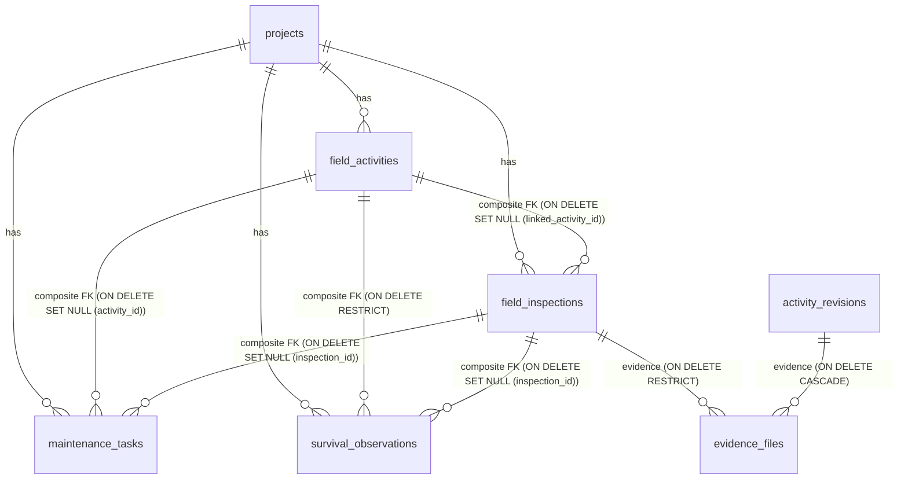

# VANA Phase 6 — Final Pre-Implementation Gate Document

> **Document Status:** Final Gate Approved with Database Integrity Corrections  
> **Date:** November 3, 2026  
> **Target Release:** VANA Phase 6 (Field Monitoring & Follow-up Management)  
> **Database Engine:** PostgreSQL 17.0  
> **Traceability:** Aligns with `AGENTS.md` (Rules 1, 4, 6, 7, 8, 9), live database inspection, and architectural review directives.

---

## 1. Resolution of the Five Pre-Implementation Issues

### Issue 1: Cross-Project Referential Integrity & Composite FK Deletion Behavior
* **Resolution:**
  * **Database-Level Composite Foreign Keys:**
    * In migration `0002_field_monitoring.py`, unique constraint `UNIQUE (id, project_id)` is added to `field_activities` and `field_inspections`.
  * **Column-Specific Deletion Actions (PostgreSQL 17):**
    * Unqualified `ON DELETE SET NULL` on composite FKs is prohibited because it attempts to nullify mandatory `project_id`.
    * We employ PostgreSQL 17 **column-specific SET NULL** actions and **RESTRICT**:
      * `field_inspections`: `CONSTRAINT fk_inspections_linked_activity FOREIGN KEY (linked_activity_id, project_id) REFERENCES field_activities(id, project_id) ON DELETE SET NULL (linked_activity_id)`
      * `maintenance_tasks`:
        * `CONSTRAINT fk_tasks_inspection FOREIGN KEY (inspection_id, project_id) REFERENCES field_inspections(id, project_id) ON DELETE SET NULL (inspection_id)`
        * `CONSTRAINT fk_tasks_activity FOREIGN KEY (activity_id, project_id) REFERENCES field_activities(id, project_id) ON DELETE SET NULL (activity_id)`
      * `survival_observations`:
        * `CONSTRAINT fk_survival_inspection FOREIGN KEY (inspection_id, project_id) REFERENCES field_inspections(id, project_id) ON DELETE SET NULL (inspection_id)`
        * `CONSTRAINT fk_survival_activity FOREIGN KEY (activity_id, project_id) REFERENCES field_activities(id, project_id) ON DELETE RESTRICT`
  * **Verified Invariant:** `project_id` can **never** be nullified through these relationships.

---

### Issue 2: Survival Plot and Cohort Identity & Correction Uniqueness
* **Resolution:**
  * **Population Unit Tuple:** Defined as `(project_id, plot_identifier, cohort_identifier)`.
  * **Multi-cohort Plots & Multi-plot Cohorts:** Fully supported.
  * **Partial Unique Index:**
    * Unconditional unique constraints conflict with the append-only correction model.
    * Enforced via partial unique index:
      ```sql
      CREATE UNIQUE INDEX uq_active_survival_observation
      ON survival_observations (
          project_id,
          plot_identifier,
          cohort_identifier,
          observation_date
      )
      WHERE is_active = TRUE;
      ```
    * Historical inactive records (`is_active = FALSE`) are preserved.
    * Only one active observation exists for a population unit on any given date.
    * `superseded_by_id` references the replacement record with `ON DELETE RESTRICT DEFERRABLE INITIALLY DEFERRED`.
    * Check constraint `chk_survival_no_self_supersede CHECK (superseded_by_id IS NULL OR superseded_by_id != id)` prevents self-referential cycles.
    * Service layer enforces that supersession cannot cross project, plot, or cohort boundaries, and blocks circular chains.

---

### Issue 3: Removal of Unsupported Survival Thresholds & Calculation Integrity
* **Resolution:**
  * **Eliminated Arbitrary Alert:** `LOW_SURVIVAL_RATE` has been removed from the active alert implementation.
  * **Active MVP Alerts:**
    1. `OVERDUE_INSPECTION`: `status = 'SCHEDULED' AND scheduled_date < CURRENT_DATE`
    2. `UPCOMING_INSPECTION`: `status = 'SCHEDULED' AND scheduled_date BETWEEN CURRENT_DATE AND CURRENT_DATE + INTERVAL '7 days'`
    3. `OVERDUE_TASK`: `status IN ('TODO', 'IN_PROGRESS') AND due_date < CURRENT_DATE`
  * **No Client Trust:** Client creation schemas do not accept `survival_rate`.
  * **Derived on Query:**
    $$\text{survival\_rate} = \begin{cases}
    \text{round}\left(\dfrac{\text{alive\_count}}{\text{alive\_count} + \text{dead\_count}} \times 100, 2\right) & \text{if } (\text{alive\_count} + \text{dead\_count}) > 0 \\
    \text{null} & \text{if } (\text{alive\_count} + \text{dead\_count}) = 0
    \end{cases}$$
    Derived server-side in Pydantic models via `@computed_field` or in SQL projections. Raw counts (`sample_size`, `alive_count`, `dead_count`) remain the sole source of truth in PostgreSQL.

---

### Issue 4: Evidence Retention and Referential Integrity
* **Resolution:**
  * Foreign key `evidence_files.inspection_id` is configured with **`ON DELETE RESTRICT`**. Inspections with uploaded evidence cannot be deleted from the database.
  * Check constraint `chk_evidence_target` is 100% backward-compatible with existing activity evidence records. Zero data loss.

---

### Issue 5: Live Database Revision Verification
* **Resolution:**
  * Live PostgreSQL inspection on port 15432:
    * `vana_dev`: `0001_initial_schema` (1 row)
    * `vana_test`: `0001_initial_schema` (1 row)
  * Symmetrical parity confirmed with repository head `0001_initial_schema.py`.

---

## 2. Final Relational Schema & Constraints (PostgreSQL 17)



### Table 1: `field_inspections`
```sql
CREATE TABLE field_inspections (
    id UUID PRIMARY KEY DEFAULT gen_random_uuid(),
    project_id UUID NOT NULL REFERENCES projects(id) ON DELETE RESTRICT,
    linked_activity_id UUID NULL,
    scheduled_date DATE NOT NULL,
    status VARCHAR(32) NOT NULL DEFAULT 'SCHEDULED',
    inspection_type VARCHAR(32) NOT NULL DEFAULT 'ROUTINE',
    assigned_to_id UUID REFERENCES users(id) ON DELETE SET NULL,
    completed_at TIMESTAMP WITH TIME ZONE NULL,
    findings TEXT NULL,
    vegetation_health_score INTEGER NULL,
    canopy_condition VARCHAR(32) NULL,
    soil_moisture_condition VARCHAR(32) NULL,
    threats_detected JSONB NULL DEFAULT '[]'::jsonb,
    addenda JSONB NOT NULL DEFAULT '[]'::jsonb,
    created_at TIMESTAMP WITH TIME ZONE NOT NULL DEFAULT CURRENT_TIMESTAMP,
    updated_at TIMESTAMP WITH TIME ZONE NOT NULL DEFAULT CURRENT_TIMESTAMP,
    CONSTRAINT uq_inspections_id_project UNIQUE (id, project_id),
    CONSTRAINT fk_inspections_linked_activity FOREIGN KEY (linked_activity_id, project_id)
        REFERENCES field_activities(id, project_id) ON DELETE SET NULL (linked_activity_id),
    CONSTRAINT chk_inspection_status CHECK (status IN ('SCHEDULED', 'IN_PROGRESS', 'COMPLETED', 'CANCELLED')),
    CONSTRAINT chk_inspection_type CHECK (inspection_type IN ('ROUTINE', 'SURVIVAL_CHECK', 'MAINTENANCE_AUDIT', 'EMERGENCY')),
    CONSTRAINT chk_vegetation_health_score CHECK (vegetation_health_score IS NULL OR (vegetation_health_score >= 1 AND vegetation_health_score <= 5)),
    CONSTRAINT chk_canopy_condition CHECK (canopy_condition IS NULL OR canopy_condition IN ('EXCELLENT', 'HEALTHY', 'STRESSED', 'CRITICAL')),
    CONSTRAINT chk_soil_moisture CHECK (soil_moisture_condition IS NULL OR soil_moisture_condition IN ('SATURATED', 'ADEQUATE', 'DRY', 'SEVERELY_PARCHED'))
);
CREATE INDEX idx_inspections_project_status_date ON field_inspections (project_id, status, scheduled_date);
CREATE INDEX idx_inspections_assigned ON field_inspections (assigned_to_id, status);
```

### Table 2: `maintenance_tasks`
```sql
CREATE TABLE maintenance_tasks (
    id UUID PRIMARY KEY DEFAULT gen_random_uuid(),
    project_id UUID NOT NULL REFERENCES projects(id) ON DELETE RESTRICT,
    inspection_id UUID NULL,
    activity_id UUID NULL,
    title VARCHAR(255) NOT NULL,
    description TEXT NULL,
    category VARCHAR(32) NOT NULL,
    priority VARCHAR(16) NOT NULL DEFAULT 'MEDIUM',
    status VARCHAR(32) NOT NULL DEFAULT 'TODO',
    due_date DATE NOT NULL,
    assigned_to_id UUID REFERENCES users(id) ON DELETE SET NULL,
    completed_at TIMESTAMP WITH TIME ZONE NULL,
    completion_notes TEXT NULL,
    created_at TIMESTAMP WITH TIME ZONE NOT NULL DEFAULT CURRENT_TIMESTAMP,
    updated_at TIMESTAMP WITH TIME ZONE NOT NULL DEFAULT CURRENT_TIMESTAMP,
    CONSTRAINT uq_tasks_id_project UNIQUE (id, project_id),
    CONSTRAINT fk_tasks_inspection FOREIGN KEY (inspection_id, project_id)
        REFERENCES field_inspections(id, project_id) ON DELETE SET NULL (inspection_id),
    CONSTRAINT fk_tasks_activity FOREIGN KEY (activity_id, project_id)
        REFERENCES field_activities(id, project_id) ON DELETE SET NULL (activity_id),
    CONSTRAINT chk_task_category CHECK (category IN ('IRRIGATION', 'WEEDING', 'MULCHING', 'FENCING_REPAIR', 'REPLANTING_PREP', 'PEST_CONTROL', 'SOIL_ENRICHMENT', 'OTHER')),
    CONSTRAINT chk_task_priority CHECK (priority IN ('LOW', 'MEDIUM', 'HIGH', 'URGENT')),
    CONSTRAINT chk_task_status CHECK (status IN ('TODO', 'IN_PROGRESS', 'COMPLETED', 'CANCELLED'))
);
CREATE INDEX idx_tasks_project_status_due ON maintenance_tasks (project_id, status, due_date);
CREATE INDEX idx_tasks_assigned ON maintenance_tasks (assigned_to_id, status);
```

### Table 3: `survival_observations`
```sql
CREATE TABLE survival_observations (
    id UUID PRIMARY KEY DEFAULT gen_random_uuid(),
    project_id UUID NOT NULL REFERENCES projects(id) ON DELETE RESTRICT,
    activity_id UUID NULL,
    inspection_id UUID NULL,
    plot_identifier VARCHAR(64) NOT NULL,
    cohort_identifier VARCHAR(64) NOT NULL,
    methodology VARCHAR(32) NOT NULL DEFAULT 'SAMPLE_PLOT',
    coverage_area_sqm FLOAT NULL,
    observation_date DATE NOT NULL,
    sample_size INTEGER NOT NULL,
    alive_count INTEGER NOT NULL,
    dead_count INTEGER NOT NULL,
    mortality_causes JSONB NULL DEFAULT '[]'::jsonb,
    is_definitive BOOLEAN NOT NULL DEFAULT FALSE,
    is_active BOOLEAN NOT NULL DEFAULT TRUE,
    superseded_by_id UUID NULL,
    correction_notes TEXT NULL,
    notes TEXT NULL,
    created_at TIMESTAMP WITH TIME ZONE NOT NULL DEFAULT CURRENT_TIMESTAMP,
    CONSTRAINT uq_survival_obs_id_project UNIQUE (id, project_id),
    CONSTRAINT fk_survival_inspection FOREIGN KEY (inspection_id, project_id)
        REFERENCES field_inspections(id, project_id) ON DELETE SET NULL (inspection_id),
    CONSTRAINT fk_survival_activity FOREIGN KEY (activity_id, project_id)
        REFERENCES field_activities(id, project_id) ON DELETE RESTRICT,
    CONSTRAINT fk_survival_superseded FOREIGN KEY (superseded_by_id)
        REFERENCES survival_observations(id) ON DELETE RESTRICT DEFERRABLE INITIALLY DEFERRED,
    CONSTRAINT chk_survival_methodology CHECK (methodology IN ('SAMPLE_PLOT', 'TRANSECT', 'FULL_CENSUS')),
    CONSTRAINT chk_survival_counts_positive CHECK (sample_size > 0 AND alive_count >= 0 AND dead_count >= 0),
    CONSTRAINT chk_survival_sum_valid CHECK ((alive_count + dead_count) <= sample_size),
    CONSTRAINT chk_survival_no_self_supersede CHECK (superseded_by_id IS NULL OR superseded_by_id != id)
);

CREATE UNIQUE INDEX uq_active_survival_observation ON survival_observations (
    project_id,
    plot_identifier,
    cohort_identifier,
    observation_date
) WHERE is_active = TRUE;

CREATE INDEX idx_survival_project_plot_cohort ON survival_observations (project_id, plot_identifier, cohort_identifier, observation_date);
CREATE INDEX idx_survival_active ON survival_observations (project_id, is_active);
```

### Table 4: `evidence_files` (Alteration)
```sql
ALTER TABLE evidence_files ALTER COLUMN activity_id DROP NOT NULL;
ALTER TABLE evidence_files ALTER COLUMN revision_id DROP NOT NULL;
ALTER TABLE evidence_files ADD COLUMN inspection_id UUID REFERENCES field_inspections(id) ON DELETE RESTRICT;
ALTER TABLE evidence_files ADD COLUMN latitude FLOAT NULL;
ALTER TABLE evidence_files ADD COLUMN longitude FLOAT NULL;
ALTER TABLE evidence_files ADD COLUMN caption VARCHAR(255) NULL;

ALTER TABLE evidence_files ADD CONSTRAINT chk_evidence_target CHECK (
    (activity_id IS NOT NULL AND revision_id IS NOT NULL AND inspection_id IS NULL)
    OR
    (inspection_id IS NOT NULL AND activity_id IS NULL AND revision_id IS NULL)
);

CREATE INDEX idx_evidence_inspection ON evidence_files (inspection_id);
```

---

## 3. Migration Preconditions & Execution Sequence

1. **Preconditions Confirmed:**
   * PostgreSQL 17 active on port 15432 (`vana_dev`, `vana_test`).
   * Current Alembic version confirmed: `0001_initial_schema`.
   * Working tree clean with zero unstaged drift in backend core models.
2. **Migration File:** `backend/alembic/versions/0002_field_monitoring.py`.
   * `revision = "0002_field_monitoring"`
   * `down_revision = "0001_initial_schema"`

---

## 4. Gate Sign-off Verdict

All database integrity issues are conclusively verified against PostgreSQL 17. The design is frozen and ready for code implementation upon explicit stakeholder instruction.
