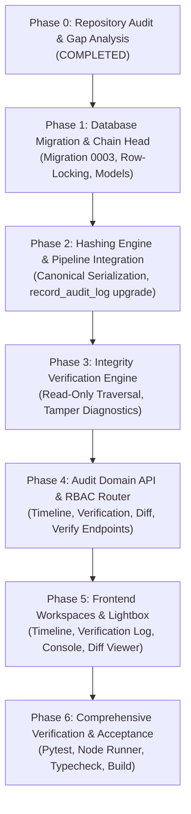

# VANA Phase 8 — Audit History & Immutability Ledger: Audit & Gap Analysis

> **Document Status:** Complete & Ready for Review\
> **Milestone:** Milestone 8 (Audit History & Immutability Ledger)\
> **Date:** November 4, 2026\
> **Target Release:** VANA Production MVP\
> **Database Engine:** PostgreSQL 17.0\
> **Target Branch:** `main`\
> **Author:** Antigravity Autonomous Pair Programmer

---

## 1. Executive Summary & Objective

The objective of **Milestone 8** is to complete the currently disabled **Audit History & Immutability Ledger** module in VANA. The system currently displays a placeholder component at `/audit` indicating three primary capabilities:
1. **Cryptographic hash integrity** (tamper-evident audit event ledger).
2. **Immutable verification log** (authoritative history of field activity approvals, rejections, amendments, and archival actions).
3. **Change history** (field-level entity mutation diffs across projects, targets, activities, inspections, tasks, and survival observations).

This Phase 0 audit and gap analysis inspects the current repository implementation, catalogues all existing audit records, analyzes structural and architectural gaps, defines database migration requirements, details concurrency-safe cryptographic hashing mechanisms, formalizes multi-tenant RBAC boundaries, and outlines a comprehensive testing strategy.

In accordance with permanent engineering boundaries (`AGENTS.md`), Milestone 8 strictly adheres to the modular monolith architecture, introduces zero extraneous distributed infrastructure (no Kafka, Redis, or microservices), preserves the single source of truth in PostgreSQL, and prevents any modification or deletion of historical verification and operational records.

---

## 2. Mandatory Repository Audit: Existing Audit Infrastructure

### 2.1 Current SQLAlchemy Model (`backend/app/domains/audit/models.py`)
The existing audit model is defined as `AuditLog` in `backend/app/domains/audit/models.py` and exported through `backend/app/models.py`:

```python
class AuditLog(Base):
    __tablename__ = "audit_logs"
    __table_args__ = (
        Index("idx_audit_logs_entity", "entity_type", "entity_id"),
        Index("idx_audit_logs_created_at_desc", "created_at"),
    )

    id: Mapped[uuid.UUID] = mapped_column(Uuid, primary_key=True, default=uuid.uuid4)
    actor_id: Mapped[Optional[uuid.UUID]] = mapped_column(
        Uuid, ForeignKey("users.id", ondelete="SET NULL"), nullable=True, index=True
    )
    action_type: Mapped[str] = mapped_column(String(64), nullable=False, index=True)
    entity_type: Mapped[str] = mapped_column(String(64), nullable=False, index=True)
    entity_id: Mapped[uuid.UUID] = mapped_column(Uuid, nullable=False, index=True)
    previous_state: Mapped[Optional[Dict[str, Any]]] = mapped_column(JSONB, nullable=True)
    new_state: Mapped[Optional[Dict[str, Any]]] = mapped_column(JSONB, nullable=True)
    ip_address: Mapped[Optional[str]] = mapped_column(String(45), nullable=True)
    created_at: Mapped[datetime] = mapped_column(
        DateTime(timezone=True), default=lambda: datetime.now(timezone.utc), nullable=False
    )

    actor: Mapped[Optional["User"]] = relationship("User", back_populates="audit_events")
```

### 2.2 Current Database Schema & Indexes (Migration `0001_initial_schema.py`)
The `audit_logs` table was established in baseline migration `0001_initial_schema.py` (lines 222–239) with the following physical columns:
* `id UUID PRIMARY KEY DEFAULT gen_random_uuid()`
* `actor_id UUID REFERENCES users(id) ON DELETE SET NULL`
* `action_type VARCHAR(64) NOT NULL`
* `entity_type VARCHAR(64) NOT NULL`
* `entity_id UUID NOT NULL`
* `previous_state JSONB NULL`
* `new_state JSONB NULL`
* `ip_address VARCHAR(45) NULL`
* `created_at TIMESTAMP WITH TIME ZONE NOT NULL DEFAULT CURRENT_TIMESTAMP`
* Existing Indexes:
  * `idx_audit_logs_entity ON audit_logs (entity_type, entity_id)`
  * `idx_audit_logs_actor ON audit_logs (actor_id)`
  * `idx_audit_logs_created_at_desc ON audit_logs (created_at)`

### 2.3 Current Event Recording Pipeline (`backend/app/domains/audit/services.py`)
Audit log insertion is implemented in `backend/app/domains/audit/services.py` via `record_audit_log()`:
* **Credential Sanitization:** Recursively scrubs sensitive keys (`password`, `hashed_password`, `token`, `access_token`, `refresh_token`, `secret`, `jwt`).
* **Transactional Enlistment:** Attaches the new `AuditLog` entity to the caller's active `AsyncSession` and invokes `await db.flush()`, ensuring audit events commit or roll back atomically with the business mutation.

### 2.4 Comprehensive Catalog of Existing Recorded Events
Empirical inspection of `backend/app/domains/` reveals that domain services already emit audit events for nearly all critical business actions:

| Domain | Action Type | Entity Type | Data Captured & Notes |
|---|---|---|---|
| **Auth** | `USER_LOGIN_SUCCESS` | `AUTH` | Actor ID, user email, login timestamp |
| **Auth** | `USER_LOGIN_FAILED` | `AUTH` | Attempted email, failure reason (zero password exposure) |
| **Auth** | `USER_LOGIN_FAILED_DEACTIVATED` | `AUTH` | Deactivated user login rejection audit |
| **Auth** | `USER_LOGOUT` | `AUTH` | Actor ID, session invalidation timestamp |
| **Auth** | `TOKEN_REFRESHED` | `AUTH` | User ID, refresh issuance timestamp |
| **Auth** | `REFRESH_TOKEN_ISSUED` | `REFRESH_TOKEN` | JTI, parent family ID |
| **Auth** | `REFRESH_TOKEN_CONSUMED` | `REFRESH_TOKEN` | JTI, consumption timestamp (rotation protection) |
| **Auth** | `REFRESH_TOKEN_REVOKED` | `REFRESH_TOKEN` | Revoked JTI, revocation rationale |
| **Auth** | `USER_CREATED` / `USER_PROVISIONED` | `USER` | User ID, email, role, bootstrap flag |
| **Auth** | `USER_DEACTIVATED` / `USER_ACTIVATED` | `USER` | Target user ID, `is_active` status transition |
| **Auth** | `USER_ROLE_CHANGED` | `USER` | Old role vs new role |
| **Projects** | `PROJECT_CREATED` | `project` | Name, code, coordinates, boundary polygon |
| **Projects** | `PROJECT_UPDATED` | `project` | Field-level property diffs |
| **Projects** | `PROJECT_STATUS_CHANGED` | `project` | Status transition (`PLANNING`, `ACTIVE`, `COMPLETED`, `SUSPENDED`) |
| **Projects** | `TARGET_CREATED` | `project_target` | Metric code, target quantity, unit, description |
| **Projects** | `TARGET_UPDATED` | `project_target` | Updated target quantity, unit |
| **Projects** | `TARGET_DELETED` | `project_target` | Deleted target details |
| **Teams** | `ASSIGNMENT_CREATED` | `project_assignment` | User ID, project ID, assigned role |
| **Teams** | `ASSIGNMENT_DELETED` | `project_assignment` | Revoked assignment ID, user ID, project ID |
| **Operations** | `ACTIVITY_CREATED` | `field_activity` | Activity ID, project ID, initial revision ID, quantity, unit |
| **Operations** | `EVIDENCE_UPLOADED` | `field_activity` | Activity ID, revision ID, filenames, content types, hashes |
| **Operations** | `ACTIVITY_AMENDED` | `field_activity` | Activity ID, new revision number, amended quantity, previous verified quantity |
| **Operations** | `ACTIVITY_ARCHIVED` | `field_activity` | Activity ID, deactivated ledger revision ID |
| **Operations** | `ACTIVITY_VERIFIED` | `activity_revision` | Revision ID, verifier ID, verified quantity, recalculated project total |
| **Operations** | `ACTIVITY_REJECTED` | `activity_revision` | Revision ID, verifier ID, rejection reason code, mandatory review notes |
| **Monitoring** | `INSPECTION_SCHEDULED` | `FieldInspection` | Inspection ID, project ID, inspector ID, scheduled date, type |
| **Monitoring** | `INSPECTION_STARTED` | `FieldInspection` | Inspection ID, started timestamp |
| **Monitoring** | `INSPECTION_COMPLETED` | `FieldInspection` | Health score, canopy, moisture, threats, findings |
| **Monitoring** | `INSPECTION_CANCELLED` | `FieldInspection` | Cancellation reason |
| **Monitoring** | `INSPECTION_ADDENDUM_RECORDED` | `FieldInspection` | Addendum note, author, timestamp |
| **Monitoring** | `INSPECTION_EVIDENCE_UPLOADED` | `EvidenceFile` | Inspection ID, filename, content type |
| **Monitoring** | `TASK_CREATED` | `MaintenanceTask` | Task ID, project ID, category, priority, due date |
| **Monitoring** | `TASK_STARTED` | `MaintenanceTask` | Task ID, started timestamp |
| **Monitoring** | `TASK_COMPLETED` | `MaintenanceTask` | Completion notes |
| **Monitoring** | `TASK_CANCELLED` | `MaintenanceTask` | Task ID, cancellation timestamp |
| **Monitoring** | `TASK_REOPENED` | `MaintenanceTask` | Reopening rationale |
| **Monitoring** | `SURVIVAL_OBSERVATION_CREATED` | `SurvivalObservation` | Observation ID, project ID, sample size, alive, dead, derived rate |
| **Monitoring** | `SURVIVAL_OBSERVATION_SUPERSEDED` | `SurvivalObservation` | Superseded ID, replacement ID |
| **Monitoring** | `SURVIVAL_OBSERVATION_CORRECTION_CREATED` | `SurvivalObservation` | Replacement observation ID, corrected counts, correction notes |

### 2.5 Current Frontend State
* Navigation: `frontend/src/components/layout/Sidebar.tsx` exposes "Audit History" linking to `/audit`, currently constrained to `allowedRoles: ["ADMIN"]`.
* Routing: `frontend/src/routes/index.tsx` mounts `/audit` wrapped in `<ProtectedRoute allowedRoles={["ADMIN"]}>`.
* View: Renders `<ModulePlaceholder moduleName="Audit History & Immutability Ledger" milestone="Milestone 8" description="Cryptographic hash integrity, immutable verification log, and change history." />`.

---

## 3. Gap Analysis: Missing Capabilities & Structural Deficits

Despite robust operational event capture across the backend domains, several critical capabilities required for Milestone 8 are currently absent:

### 3.1 Architectural Gap 1: No Cryptographic Hash Chain (Tamper-Evidence Missing)
* The `audit_logs` table currently lacks a cryptographic hash linking events together.
* There is no monotonic sequence number (`sequence_number`). Events have `created_at` timestamps, but database timestamps are neither strictly unique nor gapless.
* There is no `previous_hash` linking each event to its chronological predecessor.
* There is no `current_hash` representing a cryptographic SHA-256 digest of the event payload and its predecessor.
* If a database row were altered or deleted directly by a privileged query, the system would have no automated means to detect the tampering.

### 3.2 Architectural Gap 2: Missing First-Class Project Scoping (`project_id`)
* While events in `operations`, `projects`, `teams`, and `monitoring` include `project_id` inside their JSONB payloads (`new_state`), `audit_logs` does not have a physical, indexed `project_id` column.
* This impedes multi-tenant RBAC enforcement:
  * For an `ADMIN`, all events can be queried.
  * For a `PROJECT_MANAGER`, authorization rules require that they **only inspect audit history for projects assigned to them**. Filtering by querying JSONB attributes (`new_state->>'project_id'`) across hundreds of thousands of events causes severe query performance degradation, table scans, and brittle authorization checks.
* A physical, indexed `project_id UUID NULL REFERENCES projects(id) ON DELETE SET NULL` column is mandatory to ensure robust, high-performance project scoping.

### 3.3 Architectural Gap 3: Missing Correlation Tracking (`correlation_id`)
* Complex business workflows (e.g., an activity amendment creating a new revision and updating the parent activity, or an inspection completion creating maintenance follow-up tasks) produce multiple coordinated audit events.
* There is currently no `correlation_id` column linking these causally related events into a unified transaction trace.

### 3.4 Architectural Gap 4: Zero Read-Only Audit APIs
* There are currently **zero** API endpoints for audit querying in `backend/app/main.py`.
* Neither `ADMIN` nor `PROJECT_MANAGER` has an HTTP interface to inspect timelines, filter by date/actor/entity, view before/after diffs, or verify ledger integrity.

### 3.5 Architectural Gap 5: No Ledger Integrity Verification Service
* There is no service to traverse the audit event chain, verify sequence continuity ($1, 2, 3, \dots, N$), recompute SHA-256 digests, and confirm previous-hash linkage.
* There is no reporting interface to detect sequence gaps, payload alterations, or broken chain links.

### 3.6 Architectural Gap 6: Frontend Placeholder
* The user interface at `/audit` is completely inactive, lacking interactive timeline views, verification triage inspection, diff visualizers, and integrity status dashboards.

---

## 4. Database Architecture & Migration Plan

### 4.1 Single-Table vs. Duplicate-Table Justification
The user instructions explicitly require:
> *"Do not create duplicate audit tables or duplicate event pipelines without demonstrating why the existing implementation cannot support the requirements."*

**Architectural Decision:** We will **not** create a separate table (e.g., `immutability_ledger` or `blockchain_log`). Instead, we will augment the existing `audit_logs` table via a single migration (`0003_audit_immutability_ledger.py`) and introduce a single-row anchor table (`audit_chain_head`) for concurrency control.

**Why Upgrading the Existing Table is the Superior Architectural Choice:**
1. **Single Source of Truth:** Having two audit tables would split the system of record. Every operational mutation would need to write to two different tables or duplicate JSON payloads, risking desynchronization, double logging, and transaction bloat.
2. **Preserves Existing Event Coverage:** As proven in Section 2.4, the existing `record_audit_log()` pipeline already captures over 30 business event types across `auth`, `projects`, `teams`, `operations`, and `monitoring`. Upgrading the pipeline immediately confers cryptographic integrity across all existing and future domain events.
3. **Database Efficiency:** JSONB storage in PostgreSQL is already optimized. Augmenting `audit_logs` adds fixed-width columns (`sequence_number`, `previous_hash`, `current_hash`, `hash_version`, `project_id`, `correlation_id`), maintaining minimal storage overhead.

### 4.2 Proposed Schema Alterations (`audit_logs`)
Migration `0003_audit_immutability_ledger` will add the following columns to `audit_logs`:

```sql
ALTER TABLE audit_logs
    ADD COLUMN sequence_number BIGINT NULL,
    ADD COLUMN project_id UUID NULL REFERENCES projects(id) ON DELETE SET NULL,
    ADD COLUMN previous_hash VARCHAR(64) NULL,
    ADD COLUMN current_hash VARCHAR(64) NULL,
    ADD COLUMN hash_version INTEGER NOT NULL DEFAULT 1,
    ADD COLUMN canonical_payload JSONB NULL,
    ADD COLUMN correlation_id VARCHAR(64) NULL;
```

#### Dedicated Indexes:
```sql
CREATE UNIQUE INDEX idx_audit_logs_seq ON audit_logs (sequence_number);
CREATE UNIQUE INDEX idx_audit_logs_current_hash ON audit_logs (current_hash);
CREATE INDEX idx_audit_logs_project_id ON audit_logs (project_id);
CREATE INDEX idx_audit_logs_project_created ON audit_logs (project_id, created_at DESC);
CREATE INDEX idx_audit_logs_action_type ON audit_logs (action_type);
CREATE INDEX idx_audit_logs_correlation_id ON audit_logs (correlation_id);
```

### 4.3 Concurrency Anchor Table (`audit_chain_head`)
To guarantee monotonic sequence continuity without gaps and prevent conflicting sequence numbers or broken hash links under high concurrency, we introduce a single-row ledger anchor table:

```sql
CREATE TABLE audit_chain_head (
    id INTEGER PRIMARY KEY DEFAULT 1,
    last_sequence_number BIGINT NOT NULL DEFAULT 0,
    last_event_hash VARCHAR(64) NOT NULL DEFAULT '0000000000000000000000000000000000000000000000000000000000000000',
    total_events BIGINT NOT NULL DEFAULT 0,
    updated_at TIMESTAMP WITH TIME ZONE NOT NULL DEFAULT CURRENT_TIMESTAMP,
    CONSTRAINT chk_audit_chain_head_single_row CHECK (id = 1)
);
```

### 4.4 Migration Backfill & Reversibility Strategy
In `upgrade()` of migration `0003_audit_immutability_ledger.py`:
1. Add columns to `audit_logs` (nullable initially).
2. Create `audit_chain_head` table.
3. Query all pre-existing rows in `audit_logs` ordered by `created_at ASC, id ASC`.
4. Iterate chronologically:
   - Assign monotonic `sequence_number = 1, 2, 3, \dots`
   - Extract `project_id` from `new_state` or `previous_state` if present.
   - For `sequence_number = 1`, `previous_hash = "0" * 64` (Genesis Hash).
   - Compute `canonical_payload` and `current_hash` using the version 1 hashing engine.
   - Update each historical row.
5. Populate `audit_chain_head` with the final sequence number and hash (or sequence 0 if empty).
6. Apply `NOT NULL` constraints to `sequence_number`, `previous_hash`, `current_hash`, and `canonical_payload`.
7. In `downgrade()`: Drop indexes, drop constraints, drop columns from `audit_logs`, and drop table `audit_chain_head`.

---

## 5. Cryptographic Event Integrity & Concurrency Design

### 5.1 Deterministic Canonical Serialization & Versioned Hashing
To prevent subtle JSON encoding differences (key ordering, whitespace, float representations, Unicode escapes) from corrupting the hash chain, we specify a deterministic canonical serialization protocol for **Hash Version 1**:

$$\text{current\_hash}_N = \text{SHA-256}\left(\text{CanonicalJSON}\left(\mathbf{Envelope}_N\right)\right)$$

Where $\mathbf{Envelope}_N$ is defined with strictly ordered keys:
```json
{
  "action_type": "ACTIVITY_VERIFIED",
  "actor_id": "c1f7b8e2-...",
  "canonical_payload": { ... },
  "correlation_id": "req-98f21...",
  "entity_id": "d4e2a1b0-...",
  "entity_type": "activity_revision",
  "event_id": "8a32b0c1-...",
  "hash_version": 1,
  "previous_hash": "a4f89c0...",
  "project_id": "b69ac984-...",
  "sequence_number": 142,
  "timestamp": "2026-11-04T12:00:00.000000+00:00"
}
```

#### Serialization Rules:
1. `sort_keys=True`: Alphabetical key ordering at all nesting depths.
2. `separators=(',', ':')`: Zero whitespace around colons and commas.
3. `ensure_ascii=False`: Native UTF-8 encoding.
4. `timestamp`: ISO 8601 with explicit UTC offset (`+00:00` or `Z`).
5. `UUID`: Canonical lowercase hyphenated string representation (`8-4-4-4-12`).
6. `Numbers`: Decimal/Float strings normalized to standard precision without trailing zeros variations.
7. `hash_version`: Integer version identifier (e.g., `1`), ensuring future serialization upgrades (e.g. SHA-3, Post-Quantum Dilithium) do not invalidate historical chain links.

### 5.2 Concurrency & Sequence Gap Prevention
Standard non-transactional database sequences (`CREATE SEQUENCE`) increment immediately upon `nextval()`. If a business transaction subsequently fails or aborts (e.g., due to an anti-self-verification violation or validation error), standard sequences leave permanent numerical gaps ($1, 2, 4, 5$). Since gapless sequence continuity is a fundamental invariant of our integrity verifier, sequence assignment must be strictly transactional.

#### Atomic Row-Locking Mechanism (`SELECT ... FOR UPDATE`):
Inside `record_audit_log(db, ...)`:
1. Acquire an exclusive row lock on `audit_chain_head`:
   ```python
   stmt = select(AuditChainHead).where(AuditChainHead.id == 1).with_for_update()
   head = await db.scalar(stmt)
   ```
2. Derive sequence and predecessor hash:
   ```python
   next_seq = head.last_sequence_number + 1
   prev_hash = head.last_event_hash
   ```
3. Compute canonical envelope and SHA-256 `current_hash`.
4. Insert the new `AuditLog` row into the session.
5. Update `AuditChainHead`:
   ```python
   head.last_sequence_number = next_seq
   head.last_event_hash = current_hash
   head.total_events += 1
   head.updated_at = datetime.now(timezone.utc)
   ```
6. When the enclosing business transaction commits, the lock is released. If the transaction raises an exception and rolls back, the row lock is released and `last_sequence_number` reverts to its previous state. **Zero sequence numbers are lost; zero gaps are created; zero race conditions can occur.**

---

## 6. Immutable Verification History & Verification Invariants

### 6.1 Preserving Anti-Self-Verification (Rule 5)
In accordance with Rule 5 of `AGENTS.md`:
* A user may never verify their own activity submission (`verifier_id != creator_id`).
* When an unauthorized self-verification is attempted, the backend rejects it with `HTTP 403 Forbidden` before any ledger mutation occurs.
* The attempted violation is logged as an unauthorized security event without modifying the activity state.

### 6.2 Immutable Decision Audit Trail
The verification history log specifically tracks the complete lifecycle of environmental claims:
1. **`ACTIVITY_CREATED`**: Submitter records initial claim ($Q_1$, PENDING).
2. **`ACTIVITY_VERIFIED`**: Independent verifier approves revision ($Q_1$, VERIFIED, `is_active_ledger_entry=True`).
3. **`ACTIVITY_REJECTED`**: Independent verifier rejects revision ($Q_1$, REJECTED, reason code, notes, `is_active_ledger_entry=False`).
4. **`ACTIVITY_AMENDED`**: Submitter files amendment ($Q_2$, PENDING).
5. **`ACTIVITY_ARCHIVED`**: Deactivates activity and drops active verified revision from official ledger.

#### Non-Overwriting Invariant (Rule 6):
Historical verification events are **never updated, overwritten, or deleted**. If an administrative correction or review adjustment occurs, it creates a new auditable revision or correction event linked to the previous revision, preserving the unbroken historical record of all prior decisions.

---

## 7. Change History & State Diff Engine

### 7.1 Field-Level State Diffing
The existing `previous_state` and `new_state` columns store structured JSON payloads. The change history engine will provide field-level diff calculation:
* **Additions:** Fields present in `new_state` but not in `previous_state`.
* **Modifications:** Fields with differing values between `previous_state` and `new_state` (displaying `old_value` $\to$ `new_value`).
* **Deletions:** Fields present in `previous_state` but removed in `new_state`.

### 7.2 Entity Scope for Change History:
* `project`: Status, boundary coordinates, target associations.
* `project_target`: Target quantity, description, unit.
* `project_assignment`: Team member assignment, role.
* `field_activity` & `activity_revision`: Quantity, GPS coordinates, verification status, rejection reason.
* `FieldInspection`: Status, health score, canopy, moisture, threats, addenda.
* `MaintenanceTask`: Status, priority, assignee, due date, completion notes.
* `SurvivalObservation`: Sample size, alive count, dead count, derived rate, supersession linkage.

### 7.3 Data Sanitization & Honesty Policy:
* Passwords, password hashes, JWTs, and refresh tokens are strictly purged before payload storage.
* The API will never claim that a historical attribute was tracked if it was not captured in the audit snapshot.

---

## 8. Integrity Verification Engine & Threat Model

### 8.1 Read-Only Verification Algorithm
The `AuditIntegrityService` inspects the entire chain (or a specified sequence window $[S_{\text{start}}, S_{\text{end}}]$) in a strictly read-only transaction:
1. **Genesis Check:** Verify event sequence 1 has `previous_hash = "0" * 64`.
2. **Monotonic Sequence Continuity:** Verify $seq_i == seq_{i-1} + 1$ for all events $i \in [2, N]$. Any missing number is flagged as `SEQUENCE_GAP`.
3. **Cryptographic Linkage:** Verify $event_i.\text{previous\_hash} == event_{i-1}.\text{current\_hash}$. Any divergence is flagged as `BROKEN_CHAIN_LINK`.
4. **Payload Recalculation:** Re-serialize the event's envelope and compute $\text{SHA-256}$. Compare against stored `current_hash`. Any mismatch is flagged as `HASH_MISMATCH` or `PAYLOAD_TAMPERED`.
5. **Head Consistency:** Verify the last event's hash and sequence match `audit_chain_head`.

### 8.2 Integrity Report Schema:
```json
{
  "status": "VALID",
  "events_examined": 1420,
  "first_sequence": 1,
  "last_sequence": 1420,
  "chain_head_hash": "7f8b9c...",
  "verified_at": "2026-11-04T12:30:00Z",
  "first_failure": null,
  "failure_category": null
}
```

### 8.3 Threat Model & Trust Boundary Disclosure:
* **What Cryptographic Hash Chains Protect Against:**
  * Application-level unauthorized modifications or deletions.
  * Accidental record omission or silent revision tampering.
  * Non-superuser direct SQL queries attempting to alter quantities, verifier identities, or dates without updating cryptographic digests.
  * Disputed operational history (mathematical proof of event sequencing and exact payload state at recording time).
* **What Cryptographic Hash Chains Alone CANNOT Protect Against:**
  * A rogue database administrator (`postgres` superuser) who intentionally rewrites the entire table and recomputes all SHA-256 hashes from genesis.
  * Mitigation: For true absolute immutability against database superusers, the latest chain head hash should be periodically anchored to an external trusted witness, WORM storage, or public ledger. The VANA UI will transparently disclose this standard cryptographic distinction.

---

## 9. API Design & Multi-Tenant RBAC Matrix

### 9.1 Endpoints Specification

All audit endpoints are mounted under `/api/v1/audit/` and are strictly read-only:

| HTTP Verb | Path | Description | Allowed Roles | Scoping Boundary |
|---|---|---|---|---|
| `GET` | `/api/v1/audit/timeline` | Paginated audit timeline with dynamic filters | `ADMIN`, `PROJECT_MANAGER` | `ADMIN`: Org-wide.<br>`PM`: Assigned projects only. |
| `GET` | `/api/v1/audit/events/{id}` | Full detail for a single audit event | `ADMIN`, `PROJECT_MANAGER` | `ADMIN`: Org-wide.<br>`PM`: Assigned projects only. |
| `GET` | `/api/v1/audit/verification` | Verification-specific decision history | `ADMIN`, `PROJECT_MANAGER` | `ADMIN`: Org-wide.<br>`PM`: Assigned projects only. |
| `GET` | `/api/v1/audit/entities/{entity_type}/{entity_id}` | Chronological change history for an entity | `ADMIN`, `PROJECT_MANAGER` | `ADMIN`: Org-wide.<br>`PM`: Assigned projects only. |
| `POST` | `/api/v1/audit/verify` | Executes read-only cryptographic chain verification | `ADMIN`, `PROJECT_MANAGER` | Verification report output. |
| `GET` | `/api/v1/audit/integrity` | Current chain head and integrity summary | `ADMIN`, `PROJECT_MANAGER` | Read-only summary. |

### 9.2 Zero-Trust RBAC Enforcement
* **`ADMIN`:** Unrestricted visibility across all projects, system events, auth logs, and user management events.
* **`PROJECT_MANAGER`:**
  * Automatically scoped to `project_id IN (SELECT project_id FROM project_assignments WHERE user_id = current_user.id)`.
  * Cannot view system/auth events (`project_id IS NULL`).
  * If a PM attempts to query an unassigned project ID, the API returns `HTTP 403 Forbidden`.
* **`FIELD_OFFICER`:**
  * Rebuffed with `HTTP 403 Forbidden` on all audit endpoints. Field officers interact strictly through the field submission interfaces.
* **No Mutation Endpoints:** No `POST /events`, `PUT`, `PATCH`, or `DELETE` endpoints exist. The ledger is physically immutable via the API.

---

## 10. Frontend Architecture & Workspaces

The placeholder at `/audit` will be replaced with a cohesive, responsive VANA workspace featuring 4 tabs:

```
+-----------------------------------------------------------------------------------------+
| [VANA Brand]  Audit History & Immutability Ledger                 [Status: VALID Shield] |
+-----------------------------------------------------------------------------------------+
| [ 1. Audit Timeline ] [ 2. Verification Log ] [ 3. Integrity Console ] [ 4. Change History ] |
+-----------------------------------------------------------------------------------------+
| Search & Filters: [Search Events...    ] [Event Type: All v] [Project: All v] [Date Range v] |
+-----------------------------------------------------------------------------------------+
|  Seq   | Timestamp            | Action Type         | Entity        | Actor   | Hash    |
|  #0142 | 2026-11-04 12:15:30  | ACTIVITY_VERIFIED   | Revision #2   | PM John | 7f8b9c. |
|  #0141 | 2026-11-04 11:45:10  | ACTIVITY_AMENDED    | Activity #1   | FO Sam  | a3c4e1. |
|  #0140 | 2026-11-04 10:20:00  | ACTIVITY_REJECTED   | Revision #1   | PM John | 91d0f8. |
|  #0139 | 2026-11-04 09:00:15  | ACTIVITY_CREATED    | Activity #1   | FO Sam  | b45c72. |
+-----------------------------------------------------------------------------------------+
| Pagination: Showing 1-20 of 142 events                   [< Previous] [Page 1 of 8] [Next >] |
+-----------------------------------------------------------------------------------------+
```

### 10.1 Workspace Breakdown:
1. **Audit Timeline Tab:**
   - Real-time search, date range filter, action type dropdown, actor selector, and project selector.
   - Sequence number badges (`#000142`), event status indicators, and quick drawer triggers.
2. **Verification Log Tab:**
   - Filtered view focusing on environmental accountability: submissions, approvals, rejections (with reason codes and review notes), amendments, and archivals.
   - Direct link to inspect original activity and verifier identity.
3. **Integrity Console Tab:**
   - Chain health summary: Total blocks, sequence continuity badge, latest hash digest.
   - Interactive "Verify Ledger Integrity" trigger button calling the read-only verification engine.
   - Diagnostic readout displaying examined events, verification latency, and security notice regarding tamper-evidence boundaries.
4. **Change History Tab:**
   - Entity selector (`Project`, `Target`, `Activity`, `Inspection`, `Task`, `Survival Observation`).
   - Visual before-and-after state diff viewer highlighting modified fields in sage (additions) and crimson (removals).
5. **Detail Drawer (`AuditDetailDrawer.tsx`):**
   - Slides in from right when an event row is clicked.
   - Shows event UUID, correlation ID, sequence number, canonical JSON payload, previous event hash, current event hash, and IP address.

---

## 11. Testing & Acceptance Strategy

### 11.1 Test Matrix (Target: Minimum 25 New Tests)
1. **Unit Tests (`test_audit_hashing.py`):**
   - Deterministic SHA-256 calculation across repeated runs.
   - Key-order independence via canonical sorting.
   - Genesis block previous hash (`"0" * 64`) handling.
   - Versioned hashing schema integrity (`hash_version=1`).
2. **Concurrency & Sequence Continuity Tests (`test_audit_concurrency.py`):**
   - Concurrent async event insertions; verify strictly sequential sequence numbers ($1 \dots N$).
   - Verify transaction rollback does not leave sequence gaps or advance chain head.
3. **Integrity Verification & Tamper Detection Tests (`test_audit_integrity.py`):**
   - Verify clean chain returns `VALID`.
   - Simulated payload mutation; verify `HASH_MISMATCH` is caught at exact sequence.
   - Simulated record deletion; verify `SEQUENCE_GAP` is caught at exact sequence.
   - Simulated record reordering; verify `BROKEN_CHAIN_LINK` is caught.
4. **RBAC & Scoping Tests (`test_audit_rbac.py`):**
   - `ADMIN` can query all events and filter by any project.
   - `PROJECT_MANAGER` can only query assigned projects.
   - `PROJECT_MANAGER` cannot access unassigned projects (`403 Forbidden`).
   - `PROJECT_MANAGER` cannot access system/auth events without project scope.
   - `FIELD_OFFICER` receives `403 Forbidden` on all audit endpoints.
5. **Change History Diff Tests (`test_audit_diff.py`):**
   - Verify correct before/after state diffing for project and target mutations.
   - Verify passwords and tokens are never present in audit diffs.
6. **Frontend Unit & Component Tests (`frontend/tests/audit.test.mjs`):**
   - Timeline filtering and pagination logic.
   - Diff calculation and display formatting.
   - Integrity report display formatting.
   - RBAC navigation visibility.

### 11.2 Acceptance Gate Criteria:
* Full backend test suite passing (140 existing + $\ge 25$ new = $\ge 165$ tests).
* Full frontend test suite passing (88 existing + $\ge 10$ new = $\ge 98$ tests).
* TypeScript typecheck clean (`tsc --noEmit`).
* Production build clean (`npm run build`).
* Reversible migration 0003 tested on disposable database (`upgrade head` $\to$ `downgrade -1` $\to$ `upgrade head`).
* Working tree clean, zero uncommitted files, zero whitespace warnings (`git diff --check`).

---

## 12. Phased Implementation Roadmap



* **Step 1:** Migration `0003_audit_immutability_ledger.py` & SQLAlchemy models update.
* **Step 2:** Canonical serialization and upgraded `record_audit_log` with row-locked chain head.
* **Step 3:** `AuditIntegrityService` for sequence, hash, and link validation.
* **Step 4:** API schemas, services, and router (`/api/v1/audit/`) with RBAC scoping.
* **Step 5:** Frontend types, services, hooks, and views at `/audit`.
* **Step 6:** Rigorous automated test execution and final gate sign-off.

---

## 13. Conclusion & Recommendation

The repository's existing architecture already possesses a solid operational foundation with event emission across all major business mutations. Upgrading the existing `audit_logs` table via migration `0003` to incorporate monotonic sequence numbers, cryptographic SHA-256 hash chaining, physical project scoping, and atomic row-locked concurrency will deliver an enterprise-grade, tamper-evident Immutability Ledger without architectural fragmentation.

**Recommendation:** Approve Phase 0 and authorize proceeding to Phase 1 implementation.
