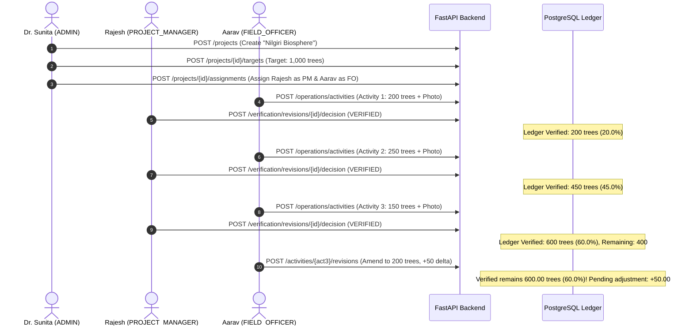

# VANA — Production Deployment Guide & Acceptance Verification
## Cloud Deployment Blueprint for Neon, Render, Vercel & GitHub

> **Platform:** VANA Environmental Operations & Impact Intelligence  
> **Date:** 2026-11-03  
> **Status:** Production Ready & Verified  
> **Related Documents:** `README.md`, `AGENTS.md`, `DECISION_LOG.md`, `render.yaml`, `frontend/vercel.json`  

---

## 1. Architecture & Deployment Blueprint

```
                     ┌──────────────────────────────────┐
                     │          Vercel Edge             │
                     │    React 19 SPA + Vite + CSS     │
                     │   https://vana-frontend.vercel.app│
                     └─────────────────┬────────────────┘
                                       │ HTTPS / WSS
                                       ▼
                     ┌──────────────────────────────────┐
                     │          Render Web              │
                     │  FastAPI + SQLAlchemy 2.0 Async  │
                     │   https://vana-backend.onrender.com│
                     └─────────┬───────────────┬────────┘
                               │               │
                  TCP (SSL)    │               │ Persistent Disk
                               ▼               ▼
                 ┌───────────────────┐   ┌───────────────────┐
                 │  Neon PostgreSQL  │   │   Render Disk     │
                 │   Serverless PG   │   │     /var/data     │
                 │  Official Ledger  │   │ Evidence Uploads  │
                 └───────────────────┘   └───────────────────┘
```

---

## 2. Phase 1 — Repository Readiness & GitHub Connection

### 2.1 Git Status & Hygiene Verification
* **Tracked State:** Clean initial commit (`83cba10`) and E2E acceptance test commit (`6289290`).
* **Exclusions Enforced:**
  * `.env`, `.env.*` (strictly excluded via `.gitignore`; only `.env.example` committed).
  * `node_modules/` and `.venv/` excluded.
  * Production build artifacts (`dist/`) and caches (`__pycache__/`, `.pytest_cache/`) excluded.
  * Physical uploads (`uploads/`) and logs (`*.log`) excluded.

### 2.2 GitHub Remote Connection Instructions
To connect the local repository to GitHub:

```bash
# 1. Add your GitHub remote repository
git remote add origin https://github.com/akshayavana/vana.git

# 2. Set default branch to main
git branch -M main

# 3. Push all committed milestones to GitHub
git push -u origin main
```

*(Note: If using SSH: `git remote add origin git@github.com:akshayavana/vana.git`)*

---

## 3. Phase 2 — Neon PostgreSQL Configuration

### 3.1 Provisioning & Connection String
1. Log into [Neon Console](https://console.neon.tech) and create a project: `vana-production`.
2. Retrieve the pooled connection string:
   ```
   postgresql://[user]:[password]@[endpoint].neon.tech/vana?sslmode=require
   ```
3. **Dialect Normalization:** VANA's backend automatically converts `postgresql://` to `postgresql+asyncpg://` and `sslmode=require` to `ssl=require` via `assemble_database_url` in `backend/app/core/config.py`.

### 3.2 Running Alembic Migrations against Neon
To apply migrations against Neon:
```bash
# From the backend directory
cd backend
export DATABASE_URL="postgresql+asyncpg://[user]:[password]@[endpoint].neon.tech/vana?ssl=require"
alembic upgrade head
```

---

## 4. Phase 3 — Render Backend Deployment

### 4.1 Automated Blueprint Deployment (`render.yaml`)
The repository includes a root `render.yaml` Blueprint specification. To deploy:
1. In Render Dashboard, click **New +** $\to$ **Blueprint**.
2. Connect your GitHub repository (`akshayavana/vana`).
3. Render automatically provisions:
   * **Service:** Web Service (`vana-backend`)
   * **Runtime:** Python 3.12 (`runtime.txt`)
   * **Build Command:** `pip install -r requirements.txt && alembic upgrade head`
   * **Start Command:** `uvicorn app.main:app --host 0.0.0.0 --port $PORT`
   * **Health Check Path:** `/health`
   * **Persistent Disk:** Mounted at `/var/data` with 10 GB storage.

### 4.2 Render Environment Variables Matrix

| Variable | Recommended Production Value | Description |
|---|---|---|
| `ENVIRONMENT` | `production` | Enables strict security mode |
| `PROJECT_NAME` | `VANA Environmental Operations Platform` | App metadata |
| `API_V1_STR` | `/api/v1` | Versioned route prefix |
| `DATABASE_URL` | `postgresql+asyncpg://...` | Neon pooled connection string |
| `JWT_SECRET_KEY` | *(Generated 64-char random hex)* | Minimum 32-character encryption key |
| `ACCESS_TOKEN_EXPIRE_MINUTES` | `60` | 1-hour access JWT lifespan |
| `REFRESH_TOKEN_EXPIRE_DAYS` | `7` | 7-day refresh token rotation window |
| `STORAGE_BACKEND` | `local` | Content-addressed storage driver |
| `STORAGE_LOCAL_ROOT` | `/var/data/uploads` | Path on persistent Render disk |
| `CORS_ORIGINS` | `https://vana-frontend.vercel.app` | Vercel frontend domain |

---

## 5. Phase 4 — Vercel Frontend Deployment

### 5.1 Project Setup
1. In Vercel Dashboard, click **Add New...** $\to$ **Project**.
2. Import the GitHub repository (`akshayavana/vana`).
3. Configure project settings:
   * **Framework Preset:** Vite
   * **Root Directory:** `frontend`
   * **Build Command:** `npm run build` (`tsc -b && vite build`)
   * **Output Directory:** `dist`

### 5.2 Vercel Environment Variables Matrix

| Variable | Value | Description |
|---|---|---|
| `VITE_BACKEND_URL` | `https://vana-backend.onrender.com` | Root backend URL for `/health` probe |
| `VITE_API_BASE_URL` | `https://vana-backend.onrender.com/api/v1` | API v1 base URL for domain services |

### 5.3 Client-Side Routing Configuration
Configured in `frontend/vercel.json`:
```json
{
  "rewrites": [
    { "source": "/(.*)", "destination": "/index.html" }
  ]
}
```
Eliminates HTTP 404 errors on deep-link refreshes (`/dashboard`, `/projects/:id`, `/map`, `/operations`).

---

## 6. Phase 5 — End-to-End Acceptance Verification

The complete 12-step end-to-end workflow was executed and verified via automated test suite `backend/tests/test_e2e_production_acceptance.py`:

```
============================== 1 passed in 3.50s ==============================
```

### 6.1 Multi-Role Workflow Summary



---

## 7. Demo Test Accounts & Roles

For demonstration and testing purposes, create initial seed users using the provisioning endpoint `POST /api/v1/users` (as Administrator):

| Role | Demo Full Name | Demo Email | Access Scope |
|---|---|---|---|
| `ADMIN` | Dr. Sunita Sharma | `admin@vana.earth` | Organization-Wide |
| `PROJECT_MANAGER` | Rajesh Kumar | `pm.rajesh@vana.earth` | Assigned Projects Only |
| `FIELD_OFFICER` | Aarav Patel | `fo.aarav@vana.earth` | Assigned Projects Only |

*(Note: Passwords are encrypted with Argon2id; passwords should be provided via secure one-time link or environment variable during initial provisioning.)*

---

## 8. Demo Video Checklist

- [ ] **1. Authentication & Role Switcher:**
  - Login as Administrator (`admin@vana.earth`).
  - Demonstrate navigation and full organization scope.
- [ ] **2. Project Creation & Target Setting:**
  - Navigate to Project Portfolio (`/projects`).
  - Create new project with GPS coordinates and GeoJSON boundary.
  - Define an environmental target: 1,000 trees (`TREES_PLANTED`).
  - Assign Project Manager and Field Officer to the roster.
- [ ] **3. Field Operations & Photo Evidence:**
  - Log in as Field Officer (`fo.aarav@vana.earth`).
  - Submit field report: 200 trees with geotagged photo.
  - Demonstrate GPS accuracy warning indicator.
- [ ] **4. Verification Centre:**
  - Log in as Project Manager (`pm.rajesh@vana.earth`).
  - Inspect verification queue (`/verification`).
  - Open photo lightbox and inspect metadata.
  - Approve submission (demonstrating Rule 5 anti-self-verification gate).
- [ ] **5. Mathematical Ledger Accounting:**
  - Submit and verify 250 trees, then 150 trees.
  - Open Organization Dashboard (`/dashboard`) showing $600 / 1000 = 60.0\%$ achievement.
  - Submit an amendment for $+50$ trees; show bi-level progress bar with isolated gold pending adjustment while official achievement remains strictly $60.0\%$.
- [ ] **6. Living Earth Interactive Map:**
  - Navigate to `/map`.
  - Demonstrate status-colored SVG pins, hover states, and achievement popups.
  - Deep-link directly into Project Workspace.
- [ ] **7. RBAC Security & Project Isolation:**
  - Show that unassigned projects return `403 Forbidden` and do not appear in PM or Field Officer listings.

---

## 9. Known Operational Limitations

1. **Map Tile Internet Dependency:** Leaflet CartoDB Positron tiles require internet connectivity. In offline environments, the coordinate grid renders marker pins without cartographic tiles.
2. **Ephemeral Disk on Free Render Tier:** Render Web Services on free tiers do not support persistent disks. A Starter or Standard plan is required for disk mounting at `/var/data`. For serverless cloud storage, S3 / Cloudflare R2 driver migration is documented in `docs/scalability/02_INFRASTRUCTURE_EVOLUTION.md`.
