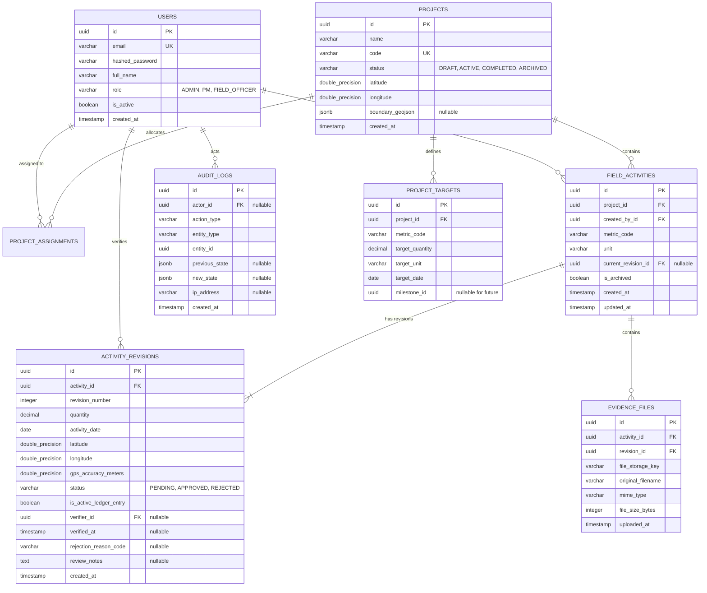

# VANA — Database Design & Schema Specification

This document details the relational schema, entity relationships, constraints, indexes, and migration strategy for VANA.

---

## 1. Entity-Relationship Diagram (ERD)



---

## 2. Table Schemas & PostgreSQL DDL Specifications

### 2.1 Table: `users`
Represents platform actors and role credentials.
```sql
CREATE TABLE users (
    id UUID PRIMARY KEY DEFAULT gen_random_uuid(),
    email VARCHAR(255) NOT NULL UNIQUE,
    hashed_password VARCHAR(255) NOT NULL,
    full_name VARCHAR(150) NOT NULL,
    role VARCHAR(32) NOT NULL CHECK (role IN ('ADMIN', 'PROJECT_MANAGER', 'FIELD_OFFICER')),
    is_active BOOLEAN NOT NULL DEFAULT TRUE,
    created_at TIMESTAMPTZ NOT NULL DEFAULT CURRENT_TIMESTAMP,
    updated_at TIMESTAMPTZ NOT NULL DEFAULT CURRENT_TIMESTAMP
);

CREATE INDEX idx_users_role ON users(role);
CREATE INDEX idx_users_email ON users(email);
```

---

### 2.2 Table: `projects`
Represents conservation initiatives and their geographic locations.
```sql
CREATE TABLE projects (
    id UUID PRIMARY KEY DEFAULT gen_random_uuid(),
    name VARCHAR(255) NOT NULL,
    code VARCHAR(64) NOT NULL UNIQUE,
    description TEXT,
    status VARCHAR(32) NOT NULL DEFAULT 'ACTIVE' 
        CHECK (status IN ('DRAFT', 'ACTIVE', 'COMPLETED', 'ARCHIVED')),
    latitude DOUBLE PRECISION NOT NULL 
        CHECK (latitude >= -90.0 AND latitude <= 90.0),
    longitude DOUBLE PRECISION NOT NULL 
        CHECK (longitude >= -180.0 AND longitude <= 180.0),
    boundary_geojson JSONB NULL,
    created_at TIMESTAMPTZ NOT NULL DEFAULT CURRENT_TIMESTAMP,
    updated_at TIMESTAMPTZ NOT NULL DEFAULT CURRENT_TIMESTAMP
);

CREATE INDEX idx_projects_status ON projects(status);
CREATE INDEX idx_projects_coordinates ON projects(latitude, longitude);
```

---

### 2.3 Table: `project_assignments`
Maps users (PMs and Field Officers) to specific project rosters.
```sql
CREATE TABLE project_assignments (
    id UUID PRIMARY KEY DEFAULT gen_random_uuid(),
    project_id UUID NOT NULL REFERENCES projects(id) ON DELETE CASCADE,
    user_id UUID NOT NULL REFERENCES users(id) ON DELETE CASCADE,
    assigned_role VARCHAR(32) NOT NULL 
        CHECK (assigned_role IN ('PROJECT_MANAGER', 'FIELD_OFFICER')),
    assigned_at TIMESTAMPTZ NOT NULL DEFAULT CURRENT_TIMESTAMP,
    UNIQUE (project_id, user_id)
);

CREATE INDEX idx_project_assignments_user ON project_assignments(user_id);
CREATE INDEX idx_project_assignments_project ON project_assignments(project_id);
```

---

### 2.4 Table: `project_targets`
Establishes dimensional environmental targets for each project.
```sql
CREATE TABLE project_targets (
    id UUID PRIMARY KEY DEFAULT gen_random_uuid(),
    project_id UUID NOT NULL REFERENCES projects(id) ON DELETE CASCADE,
    metric_code VARCHAR(64) NOT NULL,
    target_quantity NUMERIC(14, 2) NOT NULL CHECK (target_quantity > 0),
    target_unit VARCHAR(32) NOT NULL,
    target_date DATE NOT NULL,
    milestone_id UUID NULL, -- Nullable column reserved for future Phase 2 milestones
    created_at TIMESTAMPTZ NOT NULL DEFAULT CURRENT_TIMESTAMP,
    updated_at TIMESTAMPTZ NOT NULL DEFAULT CURRENT_TIMESTAMP
);

-- Partial unique indexes to safely handle NULL milestone_id in standard PostgreSQL
CREATE UNIQUE INDEX uq_project_targets_no_milestone 
ON project_targets(project_id, metric_code) 
WHERE milestone_id IS NULL;

CREATE UNIQUE INDEX uq_project_targets_with_milestone 
ON project_targets(project_id, metric_code, milestone_id) 
WHERE milestone_id IS NOT NULL;

CREATE INDEX idx_project_targets_project ON project_targets(project_id);
```

---

### 2.5 Table: `field_activities`
The immutable logical container for a reported field intervention.
```sql
CREATE TABLE field_activities (
    id UUID PRIMARY KEY DEFAULT gen_random_uuid(),
    project_id UUID NOT NULL REFERENCES projects(id) ON DELETE RESTRICT,
    created_by_id UUID NOT NULL REFERENCES users(id) ON DELETE RESTRICT,
    metric_code VARCHAR(64) NOT NULL,
    unit VARCHAR(32) NOT NULL,
    current_revision_id UUID NULL, -- Updated as new revisions are submitted
    is_archived BOOLEAN NOT NULL DEFAULT FALSE,
    created_at TIMESTAMPTZ NOT NULL DEFAULT CURRENT_TIMESTAMP,
    updated_at TIMESTAMPTZ NOT NULL DEFAULT CURRENT_TIMESTAMP
);

CREATE INDEX idx_field_activities_project ON field_activities(project_id);
CREATE INDEX idx_field_activities_creator ON field_activities(created_by_id);
CREATE INDEX idx_field_activities_metric ON field_activities(metric_code);
CREATE INDEX idx_field_activities_archived ON field_activities(is_archived);
```

---

### 2.6 Table: `activity_revisions`
Versioned historical submissions for each logical field activity.
```sql
CREATE TABLE activity_revisions (
    id UUID PRIMARY KEY DEFAULT gen_random_uuid(),
    activity_id UUID NOT NULL REFERENCES field_activities(id) ON DELETE CASCADE,
    revision_number INTEGER NOT NULL CHECK (revision_number >= 1),
    quantity NUMERIC(14, 2) NOT NULL CHECK (quantity > 0),
    activity_date DATE NOT NULL,
    latitude DOUBLE PRECISION NULL 
        CHECK (latitude IS NULL OR (latitude >= -90.0 AND latitude <= 90.0)),
    longitude DOUBLE PRECISION NULL 
        CHECK (longitude IS NULL OR (longitude >= -180.0 AND longitude <= 180.0)),
    gps_accuracy_meters DOUBLE PRECISION NULL CHECK (gps_accuracy_meters IS NULL OR gps_accuracy_meters >= 0),
    field_notes TEXT NULL,
    status VARCHAR(32) NOT NULL DEFAULT 'PENDING' 
        CHECK (status IN ('PENDING', 'VERIFIED', 'REJECTED')),
    is_active_ledger_entry BOOLEAN NOT NULL DEFAULT FALSE,
    verifier_id UUID NULL REFERENCES users(id) ON DELETE SET NULL,
    verified_at TIMESTAMPTZ NULL,
    rejection_reason_code VARCHAR(64) NULL CHECK (
        rejection_reason_code IS NULL OR 
        rejection_reason_code IN (
            'INSUFFICIENT_EVIDENCE', 
            'COORDINATES_MISMATCH', 
            'INCORRECT_UNIT_OR_QUANTITY', 
            'DUPLICATE_SUBMISSION', 
            'DATA_ENTRY_ERROR'
        )
    ),
    review_notes TEXT NULL,
    created_at TIMESTAMPTZ NOT NULL DEFAULT CURRENT_TIMESTAMP,
    
    -- Invariant 1: Revision numbers must be unique per activity
    UNIQUE (activity_id, revision_number),

    -- Invariant 2: Active ledger entries MUST be verified revisions
    CONSTRAINT chk_active_ledger_verified CHECK (
        (is_active_ledger_entry = FALSE) OR 
        (is_active_ledger_entry = TRUE AND status = 'VERIFIED')
    ),

    -- Invariant 3: Rejections require a valid code and review notes
    CONSTRAINT chk_rejection_reason_required CHECK (
        (status != 'REJECTED') OR 
        (status = 'REJECTED' AND rejection_reason_code IS NOT NULL AND review_notes IS NOT NULL)
    ),

    -- Invariant 4: Verification must record verifier_id and verified_at
    CONSTRAINT chk_verification_signature_required CHECK (
        (status != 'VERIFIED') OR 
        (status = 'VERIFIED' AND verifier_id IS NOT NULL AND verified_at IS NOT NULL)
    )
);

-- Invariant 5: AT MOST ONE active ledger entry per logical activity (Guarantees zero double-counting)
CREATE UNIQUE INDEX uq_activity_single_active_ledger 
ON activity_revisions(activity_id) 
WHERE is_active_ledger_entry = TRUE;

CREATE INDEX idx_activity_revisions_activity ON activity_revisions(activity_id);
CREATE INDEX idx_activity_revisions_status ON activity_revisions(status);
CREATE INDEX idx_activity_revisions_active_ledger ON activity_revisions(is_active_ledger_entry);
CREATE INDEX idx_activity_revisions_verifier ON activity_revisions(verifier_id);
```

---

### 2.7 Table: `evidence_files`
Metadata for photo evidence attachments associated with submissions.
```sql
CREATE TABLE evidence_files (
    id UUID PRIMARY KEY DEFAULT gen_random_uuid(),
    activity_id UUID NOT NULL REFERENCES field_activities(id) ON DELETE CASCADE,
    revision_id UUID NOT NULL REFERENCES activity_revisions(id) ON DELETE CASCADE,
    file_storage_key VARCHAR(512) NOT NULL,
    original_filename VARCHAR(255) NOT NULL,
    mime_type VARCHAR(64) NOT NULL,
    file_size_bytes INTEGER NOT NULL CHECK (file_size_bytes > 0),
    uploaded_at TIMESTAMPTZ NOT NULL DEFAULT CURRENT_TIMESTAMP
);

CREATE INDEX idx_evidence_files_revision ON evidence_files(revision_id);
CREATE INDEX idx_evidence_files_activity ON evidence_files(activity_id);
```

---

### 2.8 Table: `audit_logs`
Immutable regulatory log tracking all sensitive state changes.
```sql
CREATE TABLE audit_logs (
    id UUID PRIMARY KEY DEFAULT gen_random_uuid(),
    actor_id UUID NULL REFERENCES users(id) ON DELETE SET NULL,
    action_type VARCHAR(64) NOT NULL,
    entity_type VARCHAR(64) NOT NULL,
    entity_id UUID NOT NULL,
    previous_state JSONB NULL,
    new_state JSONB NULL,
    ip_address VARCHAR(45) NULL,
    created_at TIMESTAMPTZ NOT NULL DEFAULT CURRENT_TIMESTAMP
);

CREATE INDEX idx_audit_logs_entity ON audit_logs(entity_type, entity_id);
CREATE INDEX idx_audit_logs_actor ON audit_logs(actor_id);
CREATE INDEX idx_audit_logs_created_at ON audit_logs(created_at DESC);
```

---

## 3. Database Constraints vs. Backend Logic Enforcement

PostgreSQL check constraints operate exclusively within the boundaries of a single row. Complex cross-table security and business rules are partitioned cleanly between the database engine and the application layer:

| Constraint / Business Invariant | Enforcement Mechanism | Rationale / Technical Architecture |
|---|---|---|
| **Zero Double-Counting (At most 1 active revision per activity)** | **PostgreSQL Engine:** Partial Unique Index (`uq_activity_single_active_ledger`) | Enforced natively by PostgreSQL storage engine; physically impossible for concurrent workers to violate. |
| **Active ledger entry must be APPROVED** | **PostgreSQL Engine:** Check Constraint (`chk_active_ledger_approved`) | Prevents pending or rejected revisions from ever contaminating active ledger aggregates. |
| **Mandatory rejection code & notes** | **PostgreSQL Engine:** Check Constraint (`chk_rejection_reason_required`) | Rejections missing structured rationale are rejected at the database level. |
| **Anti-Self-Verification Gate (`verifier_id != creator_id`)** | **Backend Service Layer + Trigger Assertion:** FastAPI Service & Optional DB Trigger | Cross-table check (`activity_revisions.verifier_id` vs `field_activities.created_by_id`) cannot be expressed in standard SQL CHECK constraints. Enforced in FastAPI dependency and verified in DB transaction. |
| **Verifier Project Assignment Check** | **Backend Service Layer:** FastAPI RBAC Dependency | Requires querying `project_assignments` table to verify membership before committing approval. |
| **Metric Code & Unit Dimension Compatibility** | **Pydantic Model + Service Layer Validator** | Validates incoming activity metrics against canonical catalog definitions before DB insertion. |
| **Atomic Recalculation Integrity** | **PostgreSQL Transaction:** `SERIALIZABLE` or `SELECT FOR UPDATE` | Recalculation of project achievement totals executes within the same atomic database transaction as the revision status update. |

---

## 4. Migration Ordering & Downgrade Behavior

To prevent foreign key dependency errors during schema evolution, Alembic migrations must execute in this strict topological order:

1. **`users`** (Independent)
2. **`projects`** (Independent)
3. **`project_assignments`** (Depends on `users`, `projects`)
4. **`project_targets`** (Depends on `projects`)
5. **`field_activities`** (Depends on `projects`, `users`)
6. **`activity_revisions`** (Depends on `field_activities`, `users`)
7. **`evidence_files`** (Depends on `field_activities`, `activity_revisions`)
8. **`audit_logs`** (Depends on `users`)
9. **Circular Reference Resolution:** Add foreign key constraint from `field_activities.current_revision_id` to `activity_revisions.id` with `DEFERRABLE INITIALLY DEFERRED`.

**Downgrade Behavior:** `alembic downgrade base` reverses this exact order in clean sequence, dropping constraints and indexes without deadlocks or foreign key violations.
